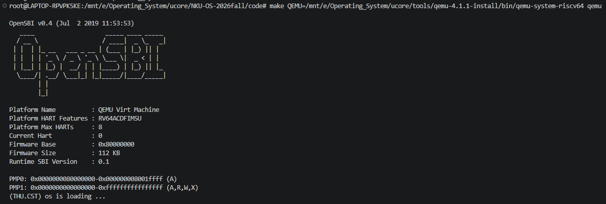
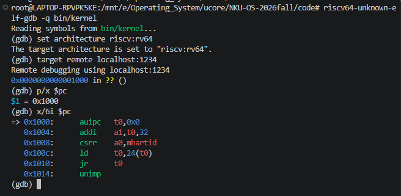
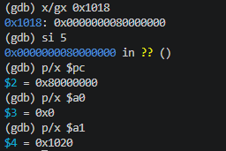
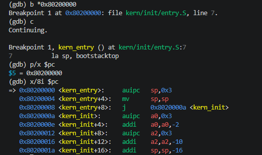

# 操作系统实验报告

## 实验基本信息

| 项目         | 内容                                         |
| ------------ | -------------------------------------------- |
| **实验名称** | Lab 1: 比麻雀更小的麻雀（最小可执行内核）    |
| **小组成员** | 2411326-张晨旭，2413042-郭桦，2411566-罗晟皓 |
| **完成日期** | 2026-10-10                                   |

### 小组分工

| 成员           | 负责的练习/模块  |
| -------------- | ---------------- |
| 2411326-张晨旭 | 练习1、练习2 |
| 2413042-郭桦   | 练习1、练习2 |
| 2411566-罗晟皓 | 练习1、练习2 |

---

## 一、实验目的

本实验以构建和分析一个最小可执行的 RISC-V 操作系统内核为主要目标，通过阅读内核源码、分析链接过程、运行 QEMU 以及使用 GDB 跟踪 CPU 启动过程，建立对操作系统从硬件启动到进入 C 语言内核代码这一完整过程的基本认识。

本实验的主要目的是：

1. 理解 RISC-V 平台下操作系统内核的启动流程。了解 CPU 加电复位后从固定复位地址开始执行代码，经过初始启动代码和 OpenSBI 固件初始化，最终将控制权移交给位于 `0x80200000` 的操作系统内核这一过程。
2. 理解内核入口代码及初始运行环境的建立过程。阅读 `kern/init/entry.S`，分析 `la sp, bootstacktop` 和 `tail kern_init` 两条关键指令，理解操作系统在进入 C 语言代码之前为什么必须首先建立自己的内核栈，以及汇编入口代码如何将 CPU 执行流转移到 `kern_init()`。
3. 理解链接脚本与内核内存布局之间的关系。通过 `tools/kernel.ld` 理解内核为什么被链接到 `0x80200000`，以及 `.text`、`.data`、`.bss` 等 section 在内存中的布局方式，进一步理解链接地址、加载地址和程序入口地址之间的关系。
4. 理解最小内核中 C 语言运行环境的初始化。分析 `kern_init()` 对 `.bss` 段进行清零以及输出启动信息的过程，认识操作系统内核需要自行完成最基本的运行环境初始化。
5. 掌握 QEMU + GDB 的基本内核调试方法。学会通过 QEMU 提供的远程调试接口连接 RISC-V GDB，并使用断点、单步执行、查看寄存器和反汇编等方式观察 CPU 从复位地址 `0x1000` 到内核入口 `0x80200000` 的实际执行过程，为后续中断、内存管理和进程调度等实验中的内核调试奠定基础。

---

## 二、实验环境

| 成员           | AI 编程工具             | 底层模型            | 备注 |
| -------------- | ----------------------- | ------------------- | ---- |
| 2411326-张晨旭 | Claude Code(vscode插件) | DeepSeek-V4.1-Flash |      |
| 2413042-郭桦   | DeepseekHarness(web)    | DeepSeek-V4.1-Flash |      |
| 2411566-罗晟皓 | Codex（VS Code 插件） | GPT6luna |      |

### 运行环境

- WSL2 / Ubuntu 22.04.4 LTS。
- RISC-V GCC 10.2.0（`/usr/bin/riscv64-unknown-elf-gcc`）。
- QEMU 4.1.1（`/usr/local/bin/qemu-system-riscv64`），OpenSBI v0.4。
- RISC-V GDB 16.3.90.20250610-git（`/mnt/e/Principles_of_Compiler_Design/environment/riscv-elf-toolchains/bin/riscv64-unknown-elf-gdb`）。

---

## 三、实验整体逻辑分析

### 3.1 本章节的逻辑主线

本实验的核心问题可以概括为：

**一台刚刚加电的 RISC-V 计算机，是如何开始执行本实验中的 C 语言内核代码的？**

整个实验是沿着计算机真实的启动顺序，自底向上逐层追踪 CPU 的控制权转移过程，整体执行路径可以概括为：

```text
QEMU loader 在虚拟 CPU 开始执行前，将 ucore.img 预加载到 0x80200000
->CPU 从复位地址 0x1000 开始执行复位代码
->复位代码跳转到 0x80000000，进入 OpenSBI
->OpenSBI 完成初始化后，将控制权移交给 0x80200000 处预先加载的 kern_entry
->kern_entry 建立内核栈并跳转到 kern_init()
->kern_init() 清零 .bss、输出启动信息并进入循环
```

`tools/kernel.ld` 将内核链接基址设为 `0x80200000`，并以 `kern_entry` 作为 ELF 入口；本实验的 QEMU 命令通过 `-device loader,file=bin/ucore.img,addr=0x80200000`，在虚拟 CPU 开始执行前把由 ELF 转换得到的原始镜像预加载到该地址。OpenSBI 完成初始化后再把执行权交给内核入口。这里的镜像由 QEMU loader 预先加载，并非 OpenSBI 从硬盘读取。

从整体结构来看，本实验展示了复位代码、OpenSBI 固件与操作系统内核之间的衔接。

### 3.2 最小内核的构建过程与模块依赖

构建从 `tools/kernel.ld` 开始：脚本把链接位置设为 `0x80200000`，指定 `kern_entry` 为程序入口，并依次安排 `.text`、`.rodata`、按页对齐后的 `.data` 和 `.sdata`、`.bss` 等区域。`edata` 标记 BSS 起点，`end` 标记其末尾，供启动代码清零使用。

复位后，OpenSBI 将控制权交给内核入口 `kern_entry`。`kern/init/entry.S` 把 `sp` 设为 `bootstacktop`，使用预留的 8 KiB 启动栈，再通过 `tail kern_init` 转入 C 入口。`kern_init()` 根据链接脚本提供的 `edata` 和 `end` 清零 BSS，然后调用 `cprintf()` 输出启动信息，最后停在循环中。

stdio 层将 `cprintf()` 产生的格式化字符交给 console 层，console 再通过 SBI 封装向 OpenSBI 请求字符输出；具体调用链和寄存器约定见下文“核心模块理解”。

Makefile 将 `kern/` 与 `libs/` 中的 C、汇编源文件交叉编译为 `obj/` 下的目标文件，再由 RISC-V 链接器依据 `tools/kernel.ld` 生成带符号信息的 `bin/kernel` ELF 文件；随后 `objcopy` 将其转换为原始二进制 `bin/ucore.img`。`make qemu` 使用默认 OpenSBI 固件启动 QEMU，并通过 loader 参数预先加载镜像。调试规则则用 `-s -S` 暂停虚拟 CPU、开放 GDB 远程端口；GDB 加载 `bin/kernel` 中的符号后，可在复位地址或 `kern_entry` 处断点、单步并查看寄存器和指令，从而核对控制流。

---

## 四、实验内容与实现

### 核心模块理解

#### `tools/kernel.ld`：链接入口与内存布局

链接脚本通过 `OUTPUT_ARCH(riscv)` 指定目标架构，通过 `ENTRY(kern_entry)` 指定 ELF 入口，并把位置计数器初始值设为 `0x80200000`。`.text` 收集入口及其他代码段，之后安排只读数据；数据段开始前按 `0x1000` 字节边界对齐，再放置 `.data` 和 `.sdata`。`edata` 位于 BSS 之前，`.bss` 收集 `.bss`、`.bss.*` 和 `.sbss*`，`end` 指向其末尾。链接地址描述 ELF 中各段的运行地址；本工程还把 `objcopy` 生成的原始镜像交给 QEMU loader 放入相同的物理地址。Lab1 尚未建立页表，不能把这里的地址布局解释为已经完成虚拟地址映射。

#### Makefile：从源文件到可启动镜像

Makefile 以 `riscv64-unknown-elf-` 为交叉工具链前缀，借助 `tools/function.mk` 收集源文件并生成目标文件。链接规则把这些目标文件和 `tools/kernel.ld` 交给 `ld`，生成 `bin/kernel`；该 ELF 保留 GDB 所需的符号信息。镜像规则再用 `objcopy --strip-all -O binary` 将 ELF 转成不带 ELF 容器信息的 `bin/ucore.img`。因此，调试时 GDB 加载 ELF 以解析符号，而 QEMU loader 加载原始镜像到 `0x80200000`。

#### SBI 输出链：从格式化字符串到 OpenSBI

`kern_init()` 调用 `cprintf()` 后，`kern/libs/stdio.c` 通过 `vcprintf()`、`vprintfmt()` 和字符回调逐个输出格式化结果。字符经 `kern/driver/console.c` 的 `cons_putc()`、`sbi_console_putchar()` 到达 `libs/sbi.c` 的 `sbi_call()`；后者把调用号放入 `x17`（`a7`），把参数放入 `x10`–`x12`（`a0`–`a2`），然后执行 `ecall`。OpenSBI 在 M 模式处理该 SBI 请求，再把字符送到模拟控制台。由此，内核无需直接操作 QEMU 的串口设备，也能输出启动信息。

---

### 练习 1：理解内核启动中的程序入口操作

**负责人：** 2411326-张晨旭、2411566-罗晟皓、2413042-郭桦

在 `kern/init/entry.S` 中，内核代码为：

```asm
kern_entry:
    la sp, bootstacktop
    tail kern_init
```

这两条指令完成了建立内核初始栈以及跳转进入 C 函数 `kern_init()` 的步骤。

#### `la sp, bootstacktop`

在 `entry.S` 定义了启动阶段使用的内核栈：

```asm
.section .data
    .align PGSHIFT
    .global bootstack
bootstack:
    .space KSTACKSIZE
    .global bootstacktop
bootstacktop:
```

其中在 mm 文件夹下有代码定义：

```c
#define KSTACKPAGE  2
#define KSTACKSIZE  (KSTACKPAGE * PGSIZE)
#define PGSIZE      4096
#define PGSHIFT     12
```

此时启动栈大小为: $KSTACKSIZE=2\times4096=8192\text{ Bytes}=8\text{ KiB}$ ，而`bootstack` 表示这片栈空间的起始地址，而 `bootstacktop` 是 `.space KSTACKSIZE` 之后的标签，因此表示这片栈空间的最高端地址。

指令:

```asm
la sp, bootstacktop
```

中的 `la` 是 RISC-V 的伪指令，含义是将符号 `bootstacktop` 对应的地址写入栈指针寄存器 `sp`。由于 RISC-V 约定使用向低地址增长的栈，因此初始 `sp` 指向栈空间的高地址，从而建立内核最初的运行栈，为后续 C 函数调用提供合适的栈环境。

#### `tail kern_init`

建立好栈以后，执行：

```asm
tail kern_init
```

`tail` 是实现尾调用的伪指令，不为这次跳转设置新的返回地址。汇编器会根据目标距离选择合适的跳转序列；本报告中的反汇编显示为 `j`，即直接跳转到 `kern_init`，进入 C 语言内核初始化函数。

```c
int kern_init(void) {
    extern char edata[], end[];
    memset(edata, 0, end - edata);

    const char *message = "(THU.CST) os is loading ...\n";
    cprintf("%s\n\n", message);
    while (1)
        ;
}
```

对于 `kern_init()`，首先会初始化 `.bss`，相关代码为：

```c
extern char edata[], end[];
memset(edata, 0, end - edata);
```

这里的 `edata` 和 `end` 在链接脚本 `tools/kernel.ld` 定义：

```ld
PROVIDE(edata = .);

.bss : {
    *(.bss)
    *(.bss.*)
    *(.sbss*)
}

PROVIDE(end = .);
```

这里将 BSS 区域清零，然后打印 `(THU.CST) os is loading ...\n`，随后进入死循环。

### 练习 2：使用 GDB 验证启动流程

**负责人：** 2411326-张晨旭、2411566-罗晟皓、2413042-郭桦

通过 GDB 远程连接 QEMU 后，先检查 CPU 的复位位置和指令：

```gdb
set architecture riscv:rv64
target remote localhost:1234
p/x $pc
x/6i $pc
```

初始 PC 为 `0x1000`，反汇编结果如下：

```asm
=> 0x1000:      auipc   t0,0x0
   0x1004:      addi    a1,t0,32
   0x1008:      csrr    a0,mhartid
   0x100c:      ld      t0,24(t0)
   0x1010:      jr      t0
   0x1014:      unimp
```

`auipc` 以当前 PC 为基准构造地址，`addi` 计算出 `a1` 的值；`csrr` 读取当前 hart 编号，随后 `ld` 从 `0x1018` 读取启动目标，`jr` 跳转到该地址。

接着查看启动目标并单步执行复位代码：

```gdb
x/gx 0x1018
si 5
p/x $pc
p/x $a0
p/x $a1
```

`0x1018` 处的值为 `0x0000000080000000`。执行后 PC 为 `0x80000000`，`a0` 为 `0x0`，`a1` 为 `0x1020`，表明 CPU 已进入 OpenSBI 入口。

最后在内核入口设置断点并继续执行：

```gdb
b *0x80200000
c
p/x $pc
x/8i $pc
```

断点设置在 `kern/init/entry.S:7`，继续执行后命中 `kern_entry`，PC 为 `0x80200000`。入口处的反汇编为：

```asm
=> 0x80200000 <kern_entry>:     auipc   sp,0x3
   0x80200004 <kern_entry+4>:   mv      sp,sp
   0x80200008 <kern_entry+8>:   j       0x8020000a <kern_init>
   0x8020000a <kern_init>:      auipc   a0,0x3
   0x8020000e <kern_init+4>:    addi    a0,a0,-2
   0x80200012 <kern_init+8>:    auipc   a2,0x3
   0x80200016 <kern_init+12>:   addi    a2,a2,-10
   0x8020001a <kern_init+16>:   addi    sp,sp,-16
```

这组观察记录了从复位地址 `0x1000`，经 OpenSBI 入口 `0x80000000`，到 uCore 入口 `0x80200000` 的连续控制流。`kern_entry` 的首段指令为后续设置启动栈并转入 `kern_init()` 做准备。

---

## 五、测试与验证

1. **QEMU 启动。** 使用 QEMU 4.1.1 启动 `virt` 平台和 OpenSBI v0.4，控制台显示 `(THU.CST) os is loading ...`，说明内核启动代码已运行。

   

2. **检查复位地址。** GDB 连接 QEMU 后，PC 为 `0x1000`；反汇编显示复位代码读取启动参数并准备跳转。

   

3. **进入 OpenSBI。** 查看 `0x1018` 中的启动目标并单步执行后，PC 到达 `0x80000000`，同时观察到 `a0 = 0x0`、`a1 = 0x1020`。

   

4. **进入 uCore。** 在 `0x80200000` 设置断点并继续后，GDB 命中 `kern_entry`，PC 为 `0x80200000`，入口反汇编显示设置栈指针并跳转到 `kern_init()` 的指令。

   

上述 QEMU 与 GDB 观察验证了从复位代码、OpenSBI 到 uCore 内核入口的启动过程。下发工程缺少 `tools/grade.sh`，而 Makefile 的 `make grade` 目标依赖该脚本，因此该测试无法执行。

---

## 六、实验总结与收获

### 对操作系统的理解

通过本次实验，我们第一次从 CPU 加电开始完整观察了操作系统内核真正开始运行之前所经历的过程。相比过去将程序入口简单理解为 C/C++ 程序中的 `main()` 函数，本实验使我们认识到，操作系统内核并不存在一个已经准备好的运行环境。

普通用户程序执行之前，操作系统已经帮助程序完成了加载、地址空间建立、栈初始化以及运行库初始化等大量工作；而操作系统内核本身位于软件栈的更底层，因此这些工作必须由固件、启动代码和内核自身共同完成。

本实验中较为重要的知识点主要包括以下几个方面。

1. 复位地址与程序入口地址并不是同一个概念。

   CPU 加电后的第一条指令位于：

   ```text
   0x1000
   ```

   而内核入口位于：

   ```text
   0x80200000
   ```

   中间还需要经过复位代码和 OpenSBI。当前工程由 QEMU loader 在启动前把 `ucore.img` 放到 `0x80200000`，OpenSBI 完成运行时初始化后再移交控制权。由此可以认识到 CPU 启动和操作系统启动实际上是两个不同阶段。

2. 操作系统的启动本质上是控制权逐层转移的过程。

   本实验中存在非常清晰的执行链：

   ```text
   Hardware
       ↓
   Reset Code
       ↓
   OpenSBI
       ↓
   Kernel Assembly Entry
       ↓
   C Kernel
   ```

   每一层只负责完成下一层运行所需要的最低限度准备，然后将 CPU 控制权交给下一层。

3. 链接脚本是内核开发中的重要组成部分。

   普通应用开发中很少需要直接关心程序各 section 的地址，但操作系统内核必须精确控制 `.text`、`.data`、`.bss` 等区域的位置。

   本实验的 `tools/kernel.ld` 通过：

   ```ld
   ENTRY(kern_entry)
   BASE_ADDRESS = 0x80200000;
   ```

   明确规定内核入口和内存布局，使生成的机器代码能够在预期地址正确执行。

4. 栈是执行 C 语言代码的重要基础。

   `kern_entry` 中首先设置 `sp`，然后才进入 `kern_init()`。这说明即使只有很少的 C 语言代码，函数调用也必须建立在正确的栈环境之上。

5. `.bss` 初始化并不是天然完成的。

   在普通应用程序中，我们通常默认：

   ```c
   int x;
   ```

   这样的全局变量初始值一定为 0。

   本实验中可以看到，这一语义最终仍然需要底层代码实际完成：

   ```c
   memset(edata, 0, end - edata);
   ```

   说明许多高级语言中习以为常的规则，本质上都是由更底层的软件层次实现的。

6. GDB 能够把抽象的启动流程转化为可观察的 CPU 状态。

   通过 `si`、`x/i`、`info registers`、断点等命令，可以直接观察 PC、SP 和通用寄存器的变化，使原本仅存在于源码和实验指导书中的启动流程变成实际可以验证的执行过程。实验材料也将这些命令作为后续复杂内核调试的基础。

### 与操作系统原理的联系和差异

本实验把课堂中的“引导程序把控制权交给内核”具体化为可观察的 RISC-V 启动链：复位代码进入运行在 M 模式的 OpenSBI，固件完成运行时准备后将控制权交给运行在 S 模式的 uCore 内核。OpenSBI 与 uCore 的职责边界体现了固件服务和操作系统内核的分层；内核通过 SBI `ecall` 请求固件服务，也说明特权级之间的服务调用需要明确接口。

链接脚本和启动栈则对应了操作系统原理中的内存布局、执行上下文与运行环境初始化。链接脚本为代码和数据指定运行地址，入口汇编建立 C 代码所需的栈，`kern_init()` 清零 BSS。与已经提供进程、地址空间和运行库的普通应用不同，这个最小内核尚未建立页表或用户地址空间，Lab1 的地址布局不能等同于完整的虚拟内存管理；它也没有进入调度循环，而是在输出后停留在空循环中。

### 本实验尚未涉及的重要 OS 知识

Lab1 只建立了最小的内核启动和输出路径，还没有实现进程创建与调度、虚拟内存和页表管理、完整的中断与异常处理、同步互斥机制或文件系统。它们是操作系统的重要组成部分，但不属于本实验当前代码所提供的功能。

### AI 协作开发经验

AI 协助我们梳理内核启动链并排查 QEMU 环境问题。最初使用另一版本的 QEMU 时，OpenSBI 能够启动，但没有正常显示 uCore 启动信息；检查版本后显式使用 QEMU 4.1.1，最终观察到 `(THU.CST) os is loading ...`。这次经历说明 AI 可以帮助缩小环境排查范围，结论仍需由实际运行结果验证。

---