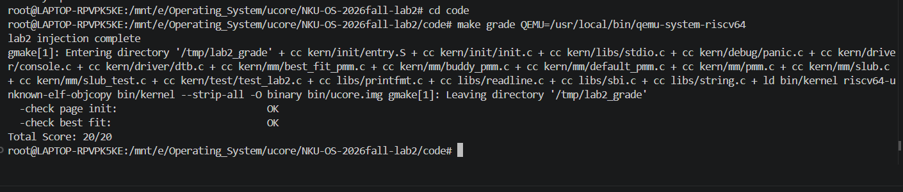
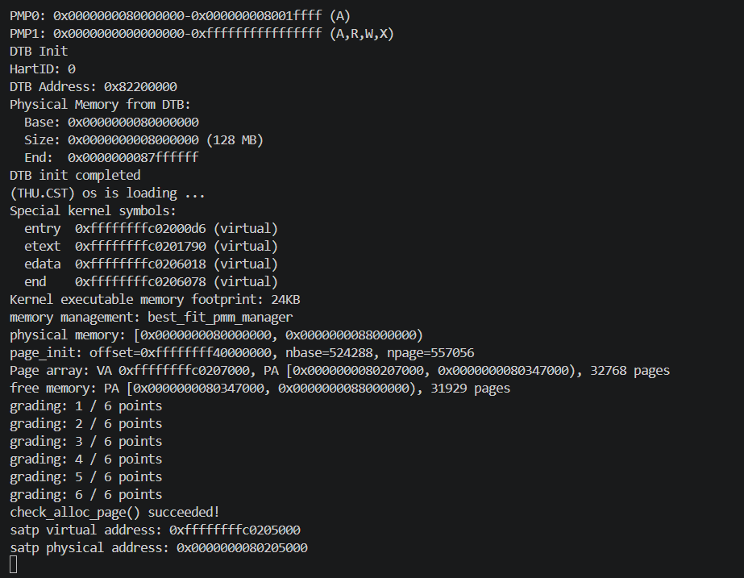
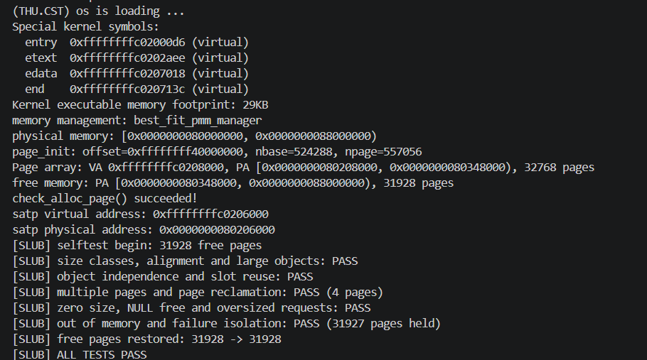

# 操作系统实验报告

## 实验基本信息

| 项目         | 内容                                         |
| ------------ | -------------------------------------------- |
| **实验名称** | lab2:物理内存和页表                          |
| **小组成员** | 2411326-张晨旭，2413042-郭桦，2411566-罗晟皓 |
| **完成日期** | 2026-10-25                                   |

### 小组分工

| 成员           | 负责的练习/模块/报告 |
| -------------- | -------------------- |
| 2411326-张晨旭 | 物理内存初始化与页表调试 |
| 2413042-郭桦   | Buddy System 实现与测试 |
| 2411566-罗晟皓 | First-Fit 分析、Best-Fit 实现及简化 SLUB 实现与测试 |

---

## 一、实验目的

1. 理解页表的建立和使用方法
2. 理解物理内存的管理方法
3. 理解页面分配算法

---

## 二、实验环境

| 成员           | AI 编程工具             | 底层模型            | 备注 |
| -------------- | ----------------------- | ------------------- | ---- |
| 2411326-张晨旭 | codex(CLI) | ChatGPT6.1sol |      |
| 2413042-郭桦   | DeepseekHarness(web)    | DeepSeek-V4.1-Flash |      |
| 2411566-罗晟皓 | OpenAI Codex（VS Code 扩展，WSL） | 6Luna |      |

### 运行环境

- WSL2 / Ubuntu 22.04.4 LTS。
- RISC-V GCC 10.2.0（`/usr/bin/riscv64-unknown-elf-gcc`）。
- QEMU 4.1.1（`/usr/local/bin/qemu-system-riscv64`），OpenSBI v0.4。
- RISC-V GDB 16.3.90.20250610-git（`/mnt/e/Principles_of_Compiler_Design/environment/riscv-elf-toolchains/bin/riscv64-unknown-elf-gdb`）。

---

## 三、实验整体逻辑分析

### 3.1 本章节的逻辑主线

Lab1 已完成内核的基本启动，Lab2 则进一步建立识别、组织和分配物理内存的能力。内核能够执行代码，并不意味着已经具备通用的动态内存管理能力：固件、内核镜像及管理数据已占用部分 DRAM，其余空间也不能未经登记便直接使用。因此，操作系统必须确定物理内存边界，区分保留页与可分配页，并提供统一的分配、释放和空闲页统计接口，避免重复分配及覆盖已有数据。

本实验需要区分地址映射与物理页分配两个层次。Sv39 页表描述虚拟地址到物理地址的对应关系，由 MMU 完成地址翻译；`Page` 描述符记录物理页的保留标志、引用计数及空闲块管理信息；分配算法则组织空闲页并决定如何满足连续页面请求。页表项与 `Page` 描述符具有不同职责：地址能够被映射访问，不代表对应物理页可以自由分配；物理页被分配，也不意味着需要立即新增页表项。

核心设计是以 4 KiB 物理页为基本管理单位，为可管理的 DRAM 页面建立连续的 `Page` 数组，再通过空闲链表和统一的 `pmm_manager` 接口组织资源。First-Fit 与 Best-Fit 分别采用首次适配和最佳适配策略选择连续空闲块；Buddy System 则按 2 的幂次组织块，并以伙伴关系约束拆分与合并。这些算法共享物理页管理框架，但具有不同的空闲块组织规则与碎片特征。

整体主线可概括为“建立启动地址映射 → 获取物理内存布局 → 初始化页面管理信息 → 建立空闲页面集合 → 提供分配与释放 → 测试与验证”。其中，启动映射在进入 C 语言内核前已启用；`page_init()` 是在该映射环境下建立物理页管理状态，而非创建 Sv39 页表。前者保证内核能够访问内存，后者保证内核能够有序地分配内存。

### 3.2 功能的逐步实现

**阶段一：建立启动页表与高地址内核运行环境。** 链接脚本将内核链接到高虚拟地址，Makefile 则将原始镜像加载到物理地址 `0x80200000`。`entry.S` 使用镜像中预设的 Sv39 根页表，以根级叶子项提供 1 GiB 启动映射，并将根表物理页号与模式字段写入 `satp`，随后执行 `sfence.vma`、设置高地址栈并跳转至 `kern_init()`。在指定启动环境中，这为后续 C 代码访问内核符号和设备树提供地址映射前提；映射覆盖范围也不等于实际可分配的 RAM 容量。

**阶段二：探测物理内存并建立页面描述符。** C 入口先清零 BSS，再由 `dtb_init()` 解析并保存 DRAM 起点和大小。随后，`pmm_init()` 先选择管理器、初始化其内部状态，再调用 `page_init()` 校验内存范围、设置地址转换偏移并确定物理页号边界。描述符数量为排他上界页号 `npage` 与起始页号 `nbase` 之差；数组布置在内核镜像之后的页对齐位置。初始化先保留全部页面，再通过 `init_memmap()` 将描述符数组之后的完整空闲页交给分配器，从而排除 OpenSBI、内核、描述符及对齐空隙的占用。只有先确定资源边界和状态，页面分配才具有安全的初始条件。

**阶段三：构建页面分配与释放机制。** `struct pmm_manager` 将初始化、空闲区注册、分配、释放、计数和自检抽象为统一接口，使上层调用与具体策略解耦。First-Fit 的基本设计是维护空闲块，查找首个足够大的连续块，分配后拆出余块，释放时按地址归还并尝试合并相邻块。在理解这组状态转换后，Best-Fit 改为选择满足请求的最小空闲块，同时保持拆分、回收与计数的一致性。当前源码默认选择 Best-Fit；两者是可替换策略，并非依次运行的两个分配阶段。

**阶段四：扩展 Buddy System。** 这是指导书中的基础任务。Buddy 按阶维护幂次页面块，请求向上取整到相应阶；分配时逐级拆分较大块，释放时仅合并同阶且满足伙伴关系的空闲块。与前两种算法相比，其差异在于块组织及拆分合并规则，可用于分析管理开销与内部碎片的权衡。当前通过 `USE_BUDDY_PMM` 编译宏独立选择该管理器。SLUB 则属于选做 Challenge，现已完成简化实现，在页级分配之上提供按大小类别组织的对象分配、槽位复用及空页回收，并通过 `SLUB_SELFTEST` 宏独立启用自检。

**阶段五：运行验证与地址翻译分析。** 内核自检、QEMU 运行和课程测试分别用于检查页面布局、分配释放约定、空闲计数及管理器接入；还需关注拆分合并、耗尽和异常释放等边界，不能由编译成功推定功能正确。QEMU/GDB 分支进一步要求用目标 GDB 控制内核访存指令，用主机 GDB 观察模拟器中的 TLB 查询、TLB Miss 和 Sv39 页表遍历，以解释地址翻译机制。代码存在、测试通过和动态调试完成是三类不同结论，应分别以源码、测试输出和调试记录为依据。

当前源码的主要初始化调用关系如下；控制台初始化、符号打印和后续空转一并列出，以区分资源初始化与实际分配服务：

```text
kern_entry
    ├── 保存 hartid 与 DTB 物理地址
    ├── 使用预设根表配置 satp，执行 sfence.vma
    ├── 设置高地址栈
    └── 跳转至 kern_init()
             ├── 清零 BSS
             ├── dtb_init()：解析并保存物理内存信息
             ├── cons_init()、启动信息与内核符号打印
             ├── pmm_init()
             │      ├── init_pmm_manager()：选择策略并初始化内部状态
             │      ├── page_init()：建立 Page 数组、保留占用页
             │      │      └── init_memmap()：注册完整空闲页
             │      ├── check_alloc_page()：调用当前管理器的自检
             │      └── 记录并打印启动根表的虚拟地址与物理地址
             ├── 定义 SLUB_SELFTEST 时：slub_init()、slub_selftest()
             └── 无限循环

后续分配服务：alloc_pages()/free_pages()/nr_free_pages()
                 └── 转发至当前 pmm_manager 的对应方法
```

---

## 四、实验内容与实现

<!-- 
说明：本部分按照 exercises 文档中的练习顺序组织
每个功能模块或者练习中可能包含多项任务，请根据实际情况调整
-->

### 4.1 功能模块一：物理内存初始化功能

**负责人：** 2411326-张晨旭

#### 4.1.1 模块功能描述

本模块对应指导书“物理内存探测与页描述符初始化”任务，主要实现 `code/kern/mm/pmm.c` 中的 `static void page_init(void)`。其职责是把设备树描述的 DRAM 范围转换为可供分配器管理的物理页集合，而非直接实现页面分配策略。

物理内存中已经存在启动固件、内核代码与数据、启动栈和页表；管理页面所需的描述符数组也占用 RAM。如果将全部 DRAM 直接登记为空闲页，后续分配就可能覆盖这些仍在使用的区域。因此，本模块先明确可管理范围和管理数据布局，再保留已占用部分，仅将剩余完整页注册给当前分配器。

每个 `Page` 是一个物理页的**软件描述符**，记录该页的引用计数、状态和链表信息。描述符数组连续排列，使物理页号与数组下标可以相互换算。初始化完成后，First-Fit、Best-Fit 等算法即可通过统一接口组织这些页面，无需自行解析设备树或重新推导内核占用边界。

Sv39 启动页表在 `entry.S` 中预设并在进入 C 入口之前启用。`page_init()` 在已有高地址映射下执行，负责物理资源状态初始化，不创建启动页表，也不写 `satp`。

#### 4.1.2 关键接口与整体设计

**初始化前提与调用关系。** `kern_init()` 先清零 BSS，再执行 `dtb_init()` 保存内存信息，随后调用 `pmm_init()`。后者先执行 `init_pmm_manager()` 初始化当前管理器，再调用 `page_init()`，最后运行分配器检查。因此，设备树解析结果和管理器内部结构都必须先于空闲区注册准备就绪。

```c
static void page_init(void);
static void init_memmap(struct Page *base, size_t n);
```

`page_init()` 无参数、无返回值，通过全局变量和管理器接口建立初始状态；遇到不受支持的布局或空间不足时调用 `panic()` 终止初始化。`init_memmap()` 是 `pmm.c` 内部的转发接口，实际执行 `pmm_manager->init_memmap(base, n)`。

| 变量 | 含义与依赖 |
|---|---|
| `struct Page *pages` | 描述符数组的内核虚拟地址；`pages[0]` 对应物理页号 `nbase`，不是物理地址零 |
| `const size_t nbase` | DRAM 起始物理页号，定义为 `DRAM_BASE / PGSIZE`；当前为 524288 |
| `size_t npage` | 可管理物理页号的排他上界，取完整 RAM 末端对应页号；不是物理页总数 |
| `uint64_t va_pa_offset` | 高地址直接映射的虚实偏移；必须先赋值，才能使用依赖它的 `PADDR()` |

| 接口或宏 | 在本模块中的作用 |
|---|---|
| `get_memory_base()`、`get_memory_size()` | 读取 `dtb_init()` 已解析并保存的 DRAM 起点、长度，本身不再次遍历 DTB |
| `PADDR(kva)` | 对适用的内核直接映射地址减去 `va_pa_offset`，得到 PA；是软件换算，不触发 MMU 查表 |
| `PPN(addr)` | 将地址右移 `PGSHIFT=12` 得到页号；本模块对物理地址使用它 |
| `ROUNDUP(addr, PGSIZE)` | 将内核尾部和描述符末端向上对齐，避免占用页被部分释放 |
| `ROUNDDOWN(addr, PGSIZE)` | 将 RAM 末端向下对齐，舍弃不足一整页的尾部 |
| `pa2page(pa)` | 将有效 PA 换成 `&pages[PPN(pa)-nbase]`，供分配器使用 |
| `init_memmap(base, n)` | 将连续的 n 个可用物理页所对应的描述符注册到当前管理器 |

这里必须使用 `count = npage - nbase`。例如，默认 `npage=557056` 表示物理页号到 557056 为止，而 DRAM 从页号 524288 才开始，实际只有 32768 页。若直接为 `npage` 个元素分配数组，就会错误地为 DRAM 以下的地址空间建立描述符，并显著扩大元数据占用。

地址换算关系为：`pages[i]` 对应 PA `(nbase+i)*PGSIZE`，有效描述符经 `page2pa()` 和 `pa2page()` 可往返。初始化只向 `pa2page()` 传入已验证位于 DRAM 内的地址；当前公共 helper 只检查页号上界，不能据此声称其对 DRAM 以下任意 PA 也能安全处理。

`struct Page` 的 `ref`、`flags`、`property` 和 `page_link` 分别服务于引用计数、页状态、块管理及链表组织。First-Fit/Best-Fit 使用 `free_area_t` 保存空闲链表头和页数，块头的 `property` 表示块长度。`pmm_manager` 则保存操作函数指针，不直接承载所有算法的内部链表。这样，初始化模块只提供正确的页集合，具体算法负责后续的空闲块状态维护。

#### 4.1.3 物理内存初始化实现

**第一步：读取并验证物理内存范围。** 设备树 getter 提供 64 位起点和长度。由于当前 `nbase` 及启动映射以固定 DRAM 基址为前提，代码要求 `mem_base == DRAM_BASE`，并拒绝零长度。计算末端前先检查加法是否溢出，之后要求排他末端不超过 `PHYSICAL_MEMORY_END=0x88000000`。。

```c
if (mem_base != DRAM_BASE || mem_size == 0 ||
    mem_size > addr_max - mem_base) {
    panic("page_init: invalid DTB memory base/size");
}
uintptr_t mem_end = mem_base + mem_size;
if (mem_end > PHYSICAL_MEMORY_END || mem_end <= mem_base) {
    panic("page_init: DTB memory exceeds the supported physical range");
}
```

这些检查保护的是 getter 返回值及后续地址运算；上游 DTB 解析器目前仅作基本校验，并不能由本段逻辑推导出对所有损坏设备树的完整防护。

**第二步：确定虚实地址对应关系。** 先将 `va_pa_offset` 设为 `PHYSICAL_MEMORY_OFFSET=0xffffffff40000000`，再使用 `PADDR(KERNBASE)` 得到内核物理加载起点 `0x80200000`。链接脚本中的 `end` 表示包含 BSS 的内核镜像布局末端虚拟地址，而非可直接用于 RAM 区间比较的物理地址。代码先验证其范围和对齐运算安全性，再换算为 `end_pa`，要求整个内核能够落在完整可管理页范围内。

**第三步：计算描述符数组。** RAM 末端先向下页对齐，再确定页号上界与元素数量；数组起点选在 `end` 之后的第一个页边界：

```c
npage = PPN(usable_end);
size_t count = npage - nbase;
size_t descriptors_size = count * sizeof(struct Page);
uintptr_t pages_va = ROUNDUP(end_va, PGSIZE);
uintptr_t pages_pa = PADDR(pages_va);
```

以上为关键计算的节选；实际代码在乘法前检查 `count` 的上界，在地址加法前分别检查虚拟地址、物理地址和数组结束地址是否溢出，并确认数组可被 RAM 容纳。这样避免“管理数据的大小尚未确认，就开始写入描述符”造成越界。

**第四步：划分保留区与空闲区。** 描述符数组末端再向上按页对齐得到 `free_pa`；只有 `[free_pa, usable_end)` 才可分配。OpenSBI 保留区、内核镜像、启动栈和根页表均处于该边界之前，描述符及对齐空隙也不会被释放。启动根表是内核 `.data` 的一部分，因此无需在本函数中重新创建或单独分配。若 `free_pa >= usable_end`，即没有完整空闲页，代码直接 panic，不以零长度调用注册接口。

默认 128 MiB 的布局以下述已核对的 [10 月 24 日 QEMU 日志](../docs/audit_logs_20261024/qemu.log) 为依据，所有区间采用**左闭右开**表示。该镜像 `end=0xffffffffc0206078`，对应 PA `0x80206078`；具体地址可能随重新链接变化，以下数值没有硬编码进初始化算法。

| 区域 | 起始物理地址 | 结束物理地址 | 是否可分配 |
|---|---|---|---|
| OpenSBI 保留区 | `0x80000000` | `0x80200000` | 否；本实验保留 2 MiB，不表示固件实际镜像占满该区间 |
| 内核镜像，含栈、启动页表和 BSS | `0x80200000` | `0x80206078` | 否 |
| 内核末端至描述符数组的对齐空间 | `0x80206078` | `0x80207000` | 否，大小 `0xf88` 字节 |
| `Page` 描述符数组 | `0x80207000` | `0x80347000` | 否，占 320 个物理页 |
| 描述符末端后的对齐间隙 | `0x80347000` | `0x80347000` | 本次为空区间，无额外占用 |
| 剩余完整空闲物理内存 | `0x80347000` | `0x88000000` | 是，共 31929 页 |

该布局中，描述符有 `557056-524288=32768` 个。按当前 RV64 结构体布局，每个 `Page` 为 40 字节，故数组占 `32768×40=1310720=0x140000` 字节，即 **320 页**。32768 是被描述的物理页数，320 才是描述符数组本身占用的页数；固件和内核占用页同样有描述符，只是保持 Reserved 状态。空闲页数则为 `(0x88000000-0x80347000)/4096=31929`。

**第五步：初始化页面元数据。** 采用“默认保留，再显式登记可用页”的策略，防止未识别区域被分配：

```c
pages = (struct Page *)pages_va;
memset(pages, 0, descriptors_size);
for (size_t i = 0; i < count; i++) {
    SetPageReserved(&pages[i]);
    list_init(&pages[i].page_link);
}
```

`memset()` 清零引用计数及块管理字段；`SetPageReserved()` 将所有页置为初始保留状态；`list_init()` 使每个嵌入链表节点成为合法的自环，而不是保留空指针。此时尚未把全部页面挂入自由链表，是否解除保留由后续空闲区注册决定。

**第六步：注册可分配页面。** 注册入口接收描述符地址和页数，而不是直接接收可用区的虚拟地址：

```c
size_t free_count = (usable_end - free_pa) >> PGSHIFT;
init_memmap(pa2page(free_pa), free_count);
```

`pa2page(free_pa)` 定位第一空闲物理页的描述符，连续的 `free_count` 个描述符对应同样连续的物理页。当前默认 Best-Fit 的注册函数要求各页原先 Reserved，随后清除这些页的保留状态、设置空闲块头并维护计数；First-Fit 遵循相同的注册前提。Buddy 也通过统一接口接收该区间，再自行按阶切分。初始化模块因此不依赖某一种空闲链表布局，也不替代分配器的合并、释放和合法性检查。

#### 4.1.4 最终提示词

仓库 [report/prompt.md 的“Lab2 功能模块一实现提示词”](prompt.md#lab2-功能模块一实现提示词) 已保存一份本任务提示词。

````markdown
# OS Lab2 — 物理内存初始化

## [PROMPT]

**任务**：在当前 Lab2 源码中，实现 `kern/mm/pmm.c` 中 `//lab2 function1 YOUR CODE` 所对应的 `static void page_init(void)`，完成物理内存信息读取、Page 描述符初始化、已占用物理内存保留和连续空闲页注册。

**操作要求**：

1. 必须先阅读仓库真实代码，再修改实际文件，不能只输出代码示例。
2. 修改范围限定为 `kern/mm/pmm.c` 中的 `page_init()` 实现位置。
3. 保留现有初始化调用流程及全部公开接口，不修改 First-Fit、Best-Fit、Buddy 或 SLUB 的代码。
4. 不得修改课程提供的测试函数和评分脚本。
5. 如果发现其他源码缺陷，单独报告，不自行扩大修改范围。
6. 实现后执行可用的构建检查，提供真实运行结果，未执行的测试明确标注。

## [RELY]

请检查并使用项目中真实存在的下列资源：

**物理内存信息**
- `get_memory_base()`
- `get_memory_size()`

**地址及页面管理**
- `KERNBASE`
- `PHYSICAL_MEMORY_OFFSET`
- `PHYSICAL_MEMORY_END`
- `DRAM_BASE`
- `PGSIZE`、`PGSHIFT`、`PPN`
- `ROUNDUP()`、`ROUNDDOWN()`
- `PADDR()`、`pa2page()`、`page2pa()`

**数据结构与状态**
- `struct Page`
- `pages`、`npage`、`nbase`
- `va_pa_offset`
- `SetPageReserved()`、`PageReserved()`

**已有函数**
- `init_memmap(struct Page *base, size_t n)`
- `panic()`、`cprintf()`

**链接符号**
- `end`

检查 `default_init_memmap()` 的状态约定，以及 `tools/test_lab2.c::test_page_init()` 中的真实测试条件。

注意：本仓库中的 `KADDR()` 已被注释，不允许直接调用。

## [GUARANTEE]

必须实现：

`static void page_init(void);`

成功返回时，必须设置：

- `va_pa_offset`
- `npage`
- `pages`

必须使用已有 `init_memmap()` 向当前物理内存管理器注册连续空闲区域。

允许根据需要增加仅在本模块内部使用的 `static` 辅助函数，但不允许新增或更改公开 API。

## [SPECIFICATION]

### page_init()

**Pre-Condition**

- `dtb_init()` 已执行，物理内存信息可以通过 getter 获得。
- `init_pmm_manager()` 已执行，当前分配器已完成基本初始化。
- Sv39 启动页表已经启用。
- 内核 `end` 符号表示内核镜像末端的虚拟地址。

**Post-Condition**

- 建立覆盖所有可管理物理页的 Page 描述符数组。
- OpenSBI、内核镜像、Page 描述符数组及对齐空隙所占用的页面均不可被分配。
- `pages[0]` 对应物理页号 `nbase`。
- 可用完整物理页被正确交给当前 `pmm_manager`。
- 对合法 Page 描述符，`pa2page(page2pa(page)) == page`。
- 物理内存范围和初始化结果可以通过内核日志检查。

**Case 1：DTB 信息合法**

读取物理内存起点及大小，检查地址范围和整数运算安全性。

设置虚实地址偏移和管理上界。

根据 `end`、描述符数量以及 `sizeof(struct Page)` 确定元数据布局。初始化全部 Page 描述符为保留状态。

从描述符数组末端之后寻找第一个完整空闲物理页，并将剩余的连续完整页面交给 `init_memmap()`。

**Case 2：DTB 信息无效**

当物理内存起点、大小、终点或地址布局不符合当前内核的管理约束时，应通过 `panic()` 终止初始化，不允许继续进行越界访问。

**Case 3：内存空间不足**

当可管理内存无法容纳内核及描述符数组，或者已经不存在完整空闲页时，不得调用 `init_memmap()`。

考虑到后续分配测试要求存在可分配页面，应输出明确原因并安全终止。

**Requirements**

1. 严格区分虚拟地址、物理地址、物理页号和 Page 描述符地址。
2. `PADDR()` 调用之前必须正确设置 `va_pa_offset`。
3. `npage` 为物理页号排他上界，描述符数量为 `npage - nbase`。
4. 检查地址加法、数组大小乘法及描述符结束地址是否溢出。
5. 描述符数组必须放置在 `end` 之后并满足页面对齐要求。
6. 只释放完整的物理页，不将任何内核或元数据页面交给分配器。
7. 不得以 `n == 0` 调用 `init_memmap()`。
8. 以当前框架的内存上界和实际代码定义为准，不得硬编码运行时 `end`、`pages` 或空闲页数量。
9. 不修改 `init_pmm_manager()` 的分配算法选择，这由集成阶段统一处理。

**最终输出**

- 实际修改的文件和代码差异。
- `page_init()` 的执行流程解释。
- 物理内存布局及地址计算方式。
- 与分配器的接口说明。
- 编译、运行及测试结果。
- 尚未验证的情况和潜在风险。
````

#### 4.1.5 实现迭代过程

#### 实现迭代过程

本模块的实现经历了1 次迭代：

**最终结果：**

经过1次迭代，该模块最终：

- ✅ 编译通过
- ✅ 所有相关测试通过
- ✅ 功能符合预期

### Challenge：硬件可用物理内存范围的获取方法

**负责人：** 2411326-张晨旭

**问题：如果 OS 无法提前知道当前硬件的可用物理内存范围，应如何获取这些信息？**

可行的方法是由更早运行、了解平台配置的启动固件或引导程序向内核提供结构化硬件描述，再由内核解析和校验。当前项目采用设备树 DTB：QEMU 的 virt 机器根据模拟硬件配置生成设备树，启动固件 OpenSBI 将 DTB 物理地址通过 `a1` 传递给内核，同时通过 `a0` 传递 hartid。内核无需假定 RAM 长度固定为 128 MiB，而是读取这份启动描述。

`entry.S` 将 `a1` 保存到 `boot_dtb`；进入已启用分页的 C 代码后，`dtb_init()` 使用固定直接映射偏移访问 DTB，检查 magic，并从 memory 节点的 `reg` 属性提取大端编码的起点和长度，保存到 `memory_base`、`memory_size`。此时 `page_init()` 尚未设置全局偏移，所以 DTB 解析使用的是 `PHYSICAL_MEMORY_OFFSET` 常量。随后 getter 将结果交给页面初始化模块。这一流程区分了“平台提供硬件描述”“内核解析描述”和“分配器管理页面”三项职责；也不要求 OpenSBI 在所有平台上都自行扫描 RAM，描述可以来自模拟器、平台配置或更早的引导阶段。

对于其他平台，同样可以通过固件提供的带类型内存映射、引导协议中的内存表或平台描述结构获取一个或多个 RAM 区间，再区分可用、保留和设备区域。

获得 RAM 范围后仍不能将其全部释放。固件、内核及引导参数占用可能位于 RAM 内，MMIO 则不能当作普通 RAM；内核还需要为 `Page` 数组等管理数据预留空间。一般应结合保留区描述和各区域生命周期，从 RAM 中扣除仍被占用的区间，再按页对齐登记空闲页。本实验按既定布局保留 OpenSBI、内核和描述符；DTB 仅在初始化时读取，内存起点和长度已复制到全局变量，指导书允许之后复用 DTB 所占空间。若后续还访问 DTB，就必须延长其保留期限，不能沿用该回收假设。

在缺少固件描述时，需依赖受支持的平台发现机制或内存控制器配置信息；不应以任意地址读写测试替代可靠的 RAM 布局获取，因为探测可能覆盖已有数据、访问 MMIO 或触发异常。


---

### 4.2 功能模块二：物理内存分配功能

本模块使用 `struct pmm_manager` 提供的接口管理连续物理页。`page_init()` 确定哪些物理页可以使用，分配器负责维护这些页的空闲状态，并响应 `alloc_pages()`、`free_pages()` 和 `nr_free_pages()`。本节先分析老师提供的 First-Fit，再说明我们在同一框架下实现的 Best-Fit；两种算法的分配单位都是页，不是任意字节大小的对象。

#### 4.2.1 任务一：First-Fit 连续物理内存分配算法

**负责人：** 2411566-罗晟皓

##### （1）算法基本原理

First-Fit 即首次适配算法。申请连续的 `n` 个物理页时，从空闲链表头开始查找，遇到第一个长度不小于 `n` 的空闲块就选中它。若块长恰好等于 `n`，取走整个块；若块更大，则分配前 `n` 页，把后面的余块继续留在空闲链表中。没有找到足够大的连续块时，分配失败。

`default_pmm.c` 按物理地址从低到高组织空闲块。链表顺序决定了“第一个”的含义，因此当前实现优先使用地址靠前的合适块，并不比较所有候选块的大小。释放后会合并物理相邻的空闲块，尽量恢复较长的连续区域。

##### （2）核心数据结构

相关定义位于 `memlayout.h`、`pmm.h` 和 `list.h`。其中，`Page` 是物理页的软件描述符，不能把描述符本身的地址直接当成该物理页的起始地址。

| 数据结构或字段 | 在 First-Fit 中的含义 |
|---|---|
| `struct Page` | 每个物理页对应一个描述符；`ref` 记录引用计数，`flags` 保存状态，`property` 和 `page_link` 用于块管理 |
| `free_area_t` | 包含空闲链表哨兵 `free_list` 和空闲物理页总数 `nr_free` |
| `free_list` | 指向各空闲块首部的双向循环链表；哨兵不是可分配页 |
| `nr_free` | 所有空闲块长度之和，单位为物理页，不是链表节点数量 |
| `property` | 对有效的空闲块首部，表示该连续块包含多少页 |
| `PG_property` | `flags` 中的空闲块首部标志，通过 `SetPageProperty()`、`ClearPageProperty()` 和 `PageProperty()` 操作 |
| `page_link` | 嵌在 `Page` 中的链表节点；`le2page(le, page_link)` 可由节点找到所属描述符 |

一个 10 页的空闲块只需要把首部的 `page_link` 挂入链表，首部设置 `property=10` 和 `PG_property`，并不是把 10 个描述符全部挂入链表。例如，空闲块长度分别为 3、5、10 时，空闲块节点数为 3，而 `nr_free=18`。

`PG_property` 只标识空闲块首部。块内其他页和已分配页都可能没有该标志，因此不能单凭某个页的 `PG_property=0` 或 `ref=0` 判断它一定已被分配。类似地，非块首部留下的 `property` 数值不应当被当作有效块长度使用。

##### （3）核心函数分析

**`default_init()`：初始化内部状态。** 调用 `list_init(&free_list)` 建立空的双向循环链表，再将 `nr_free` 清零。此时仅建立管理结构，还没有登记可用页。

**`default_init_memmap(struct Page *base, size_t n)`：登记连续空闲区。** 函数要求 `n>0`，并逐页断言原状态为 Reserved，随后清零标志、块长度和引用计数。接着设置 `base->property=n`、标记空闲块首部，将 `nr_free` 增加 `n`，再按描述符地址顺序插入链表。由于这些描述符属于同一个连续的 `pages` 数组，其先后顺序与对应物理页的顺序一致。该函数登记框架提供的区域，运行期间的相邻块合并由释放函数负责。

**`default_alloc_pages(size_t n)`：查找并分配。** 首先断言 `n>0`。若 `n>nr_free`，总空闲页数都不够，直接返回 `NULL`；否则仍需遍历链表，因为总页数足够不代表存在足够大的连续块。首次适配的关键语句为：

```c
if (p->property >= n) {
    page = p;
    break;
}
```

选中块后，先保存其前驱，再把原节点移出链表。若块长大于申请量，余块首部为 `page+n`，长度为原块长减 `n`，设置首部标志后插回原节点的位置。这样分配的是原块前面的连续页，余块仍保持地址顺序。最后将 `nr_free` 减少 `n`，清除被分配块首部的 `PG_property`。若遍历结束也没有候选块，则返回 `NULL`，不修改链表和计数。

**`default_free_pages(struct Page *base, size_t n)`：插入并合并。** 函数要求调用者归还合法的已分配区域，逐页检查不是保留页、不是已有空闲块首部，并清零标志和引用计数。随后把 `base` 设为长度为 `n` 的空闲块，增加空闲页数，再按地址找到插入位置。

有序链表使合并只需检查插入块的前驱和后继，但“链表相邻”还不等于“物理相邻”。源码用如下条件判断真正的连续关系：

```c
// 左侧空闲块 p 的末端正好接到 base。
if (p + p->property == base) {
    /* 合并到左侧块。 */
}

// 更新后的 base 的末端正好接到右侧空闲块 p。
if (base + base->property == p) {
    /* 合并右侧块。 */
}
```

先合并左侧时，需要让 `base` 改指向合并后的左块首部，然后再检查右侧，才能正确处理一次释放同时连接左右两块的情况。被吞并的块首部要清除 `PG_property` 并删除链表节点。合并只改变块的组织形式，不产生新的空闲页，因此不会再次增加 `nr_free`。

本任务以参考源码分析为主，没有改写 `default_pmm.c`；相关提示词见 [Best-Fit 实现](prompt.md#best-fit-物理内存分配器实现提示词)。

##### （4）思考题：原有的 First-Fit 算法是否有进一步的改进空间？

有。当前实现较容易理解和验证，但每次分配都从链表头重新查找。设空闲块数为 `k`，分配查找最好可以在第一个块结束，最坏要扫描全部块，时间复杂度为 `O(k)`。选中块后的摘链、拆分和插入操作为 `O(1)`。释放 `n` 页时，逐页恢复状态为 `O(n)`，查找按地址插入的位置最坏为 `O(k)`，检查并合并两个邻块为 `O(1)`，因此整个释放过程为 `O(n+k)`。

不同大小的申请与释放交替出现，会留下被已分配页隔开的空闲区域。即使 `nr_free` 足够，也可能无法满足较大的连续请求，这属于外部碎片。当前的邻块合并只能合并真正相邻的区域，无法跨过中间仍在使用的页面。First-Fit 也可能把较大的靠前空闲块切成较小余块，后续能否有效利用这些余块取决于请求序列。

源码阅读还发现一个需要注意的插入边界：参考实现的 `default_init_memmap()` 和 `default_free_pages()` 在尾插分支执行 `list_add()` 后没有立即结束遍历。新节点会成为下一次遍历的对象，可能再次作为待插入节点参与 `list_add()`，破坏前驱关系。可采用插入后立即结束遍历，或先找到位置、再在循环外统一插入一次的写法。这里记录的是静态源码分析，不是此前测试中实际出现并修复的算法 Bug；本轮保留参考文件不变。我们的 Best-Fit 使用后一种插入方式。

可以考虑以下改进，但它们都有适用条件和额外成本：

- **Next-Fit。** 保存上次查找的位置，下次从那里继续，减少总是重复扫描链表前部的情况；最坏复杂度仍为 `O(k)`。游标还必须在删除、拆分和合并节点后保持有效，碎片分布也会改变。
- **按大小分级组织空闲块。** 先定位可能容纳请求的大小级别，再在其中选择，可减少部分无效比较。但每次拆分和合并都可能改变块所属级别，需要维护更多链表及地址关系，也不再天然保留原先“按地址首次适配”的选择顺序。
- **保留地址顺序并增加查找辅助信息。** 例如用带区间最大空闲块长度信息的树，跳过不可能满足请求的区间；这有机会加快查找，但插入、删除和合并时必须同步维护辅助信息，实现与验证成本明显增加。

不能简单把链表改为按块大小降序排列，就认为是无代价优化。链表顺序本身决定首次适配选中哪个块；按大小降序查找时，第一个满足条件的往往是最大的空闲块，已经改变了当前按地址首次适配的行为。同时，释放时原有的前后链表节点未必再是物理邻块，还要另外解决邻块定位。本实验保留参考实现，通过实现 Best-Fit 比较选择策略，没有把这些理论方案加入源码。

#### 4.2.2 任务二：Best-Fit 连续物理内存分配算法

**负责人：** 2411566-罗晟皓

##### （1）模块功能描述

Best-Fit 即最佳适配算法：在所有满足申请数量的空闲块中，选择容量最小的合适块。它与 First-Fit 的主要区别是选块策略，登记、拆分、回收及相邻合并仍沿用同一物理页管理框架。

例如，按地址排列的三个空闲块分别有 8、3、5 页，申请 3 页时，First-Fit 会使用第一个 8 页块，Best-Fit 则会使用恰好为 3 页的块。这样可以避免这一次申请切分 8 页块，但不能据此保证 Best-Fit 对所有请求序列都产生更少碎片。

实现位于 `code/kern/mm/best_fit_pmm.c`。我们保留 `static free_area_t free_area` 及 `free_list`、`nr_free` 两个宏，使课程组直接访问这些状态的测试继续有效，没有另建复杂的数据结构。

##### （2）关键函数及设计

| 函数或管理器 | 职责 |
|---|---|
| `best_fit_init()` | 初始化空闲链表并将空闲页总数置零 |
| `best_fit_init_memmap(struct Page *base, size_t n)` | 初始化尚未登记的连续页并按地址插入空闲链表 |
| `best_fit_alloc_pages(size_t n)` | 选择最小合适块，执行分配与必要的拆分 |
| `best_fit_free_pages(struct Page *base, size_t n)` | 恢复页面状态、归还空闲块并合并左右邻块 |
| `best_fit_nr_free_pages()` | 返回当前 `nr_free` |
| `best_fit_pmm_manager` | 将上述实现和原有 `best_fit_check()` 接入统一接口 |

**初始化与空闲区登记。** `best_fit_init()` 使用自环哨兵表示空链表。`best_fit_init_memmap()` 断言 `n>0`，检查每页原先处于 Reserved 状态，再把 `flags`、`property` 和引用计数清零。只有首部设置 `property=n` 和 `PG_property`。插入时寻找第一个地址高于 `base` 的块，调用 `list_add_before()`；若扫描到哨兵，则插入链表末尾，空链表也适用同一写法。最后把 `nr_free` 增加 `n`。登记函数没有额外实现相邻区域合并，本实验的初始化调用一次登记完整可用连续区，运行期合并由 `best_fit_free_pages()` 完成。

**最佳空闲块搜索。** 首先排除 `n>nr_free` 的情况，再遍历整个空闲链表。`page` 保存当前最小的合适候选块，核心判断为：

```c
if (p->property >= n &&
    (page == NULL || p->property < page->property)) {
    page = p;
}
```

`p->property>=n` 保证能够提供连续的 `n` 页；后半部分使第一个可用块成为候选，并在遇到更小的合适块时更新它。不能找到任意第一个合适块就立即停止，否则会退回 First-Fit。理论上遇到恰好为 `n` 的块已不可能找到更小的合适块，可以提前结束；我们实际代码为保持逻辑直接，仍完成扫描。

更新条件使用严格小于号，而不是小于等于号。因此后面相同大小的块不会替换已有候选。链表本来按地址升序排列，所以相同大小时会确定地选择地址靠前的块。若没有候选块，`page` 保持 `NULL`，函数没有执行任何摘链或计数修改；总页数不足和总量足够但连续空间不足两种失败都不会改变原状态。

**分配与拆分。** 选中块后保存前驱、删除原块节点。恰好匹配时不再插入余块；块长大于 `n` 时，余块首部为 `page+n`，长度为原长度减 `n`，设置 `PG_property`，并用保存的前驱把余块放回原链表位置。前 `n` 页由调用者使用，后面的余块地址仍在原前后邻块之间，因此无须再次按地址搜索。成功分配后只减少 `n` 个空闲页，同时将被分配首部的 `property` 清零、清除 `PG_property`。

**回收与左右合并。** `best_fit_free_pages()` 逐页检查不是保留页、不是已有空闲块首部，并恢复 `flags=0`、`property=0`、`ref=0`。随后将归还区域组织成空闲块，按地址插入，`nr_free` 只增加实际归还的 `n` 页。接下来先检查左邻块是否结束于 `base`，再以更新后的 `base` 检查右邻块。被合并的旧首部清除标志、清零长度并移出链表。

| 物理相邻情况 | 处理结果 |
|---|---|
| 左右都不相邻 | 保留新插入块 |
| 仅左侧相邻 | 新块并入左块，`base` 改为左块首部 |
| 仅右侧相邻 | 右块并入新块，保留新块首部 |
| 左右都相邻 | 先向左合并，再吸收右块，最终保留一个较大块 |

这里比较的是描述符对应的物理连续关系，不能仅因链表前后相邻就合并。释放接口仍依赖调用者提供合法的已分配区域；现有断言不等于对任意错误指针、重复释放或越界释放的完整检测。本实验没有声称实现这些扩展能力。

**计数、注册与切换。** `best_fit_nr_free_pages()` 直接返回空闲页总数。分配成功减少 `n`，释放增加 `n`，拆分与合并本身不改变总数。`best_fit_pmm_manager` 的 `init`、`init_memmap`、`alloc_pages`、`free_pages`、`nr_free_pages` 分别指向上述五个函数，`check` 指向课程组原有的 `best_fit_check()`。

开发时在 `pmm.c` 的 `init_pmm_manager()` 中将选择语句改为 `pmm_manager = &best_fit_pmm_manager;`，没有改动成员一的 `page_init()`。队友整合 Buddy 后，当前源码使用 `USE_BUDDY_PMM` 条件编译：定义该宏时选择 Buddy，否则仍默认选择 Best-Fit。这是目前源码的实际集成状态，不能将其描述为三个管理器同时执行。

##### （3）Spec 与最终 Prompt

编写开发工单时，我们把约束分为以下几类，使实现与验收围绕同一组状态变化进行：

| Spec 项目 | 对本实现的约束 |
|---|---|
| Pre-Condition | 登记前管理器已初始化，传入未登记且原先保留的连续页；分配和释放要求 `n>0`；释放区域必须由调用者保证合法 |
| Post-Condition | 空闲块首部长度、首部标志、地址顺序和 `nr_free` 保持一致；成功分配得到所需连续页；失败不改变空闲状态 |
| Case | 区分无可用块、恰好匹配、需要拆分、多个候选块，以及回收时左邻、右邻、双邻和无邻四种情形 |
| Requirements | 在所有合适块中选择最小者；保留原有测试与任务注释；只实现 Best-Fit 及必要的管理器切换，不覆盖其他成员工作，不硬编码成功结果 |

零页申请或释放由 `assert(n>0)` 拒绝，不属于正常返回 `NULL` 的分配失败。`nr_free` 只用于排除总量不足，连续空间是否足够仍由块搜索判断。按这些条件审查代码，比只检查“能否分配一个页”更容易发现状态维护上的遗漏。

**最终 Prompt：** [Best-Fit 实现](prompt.md#best-fit-物理内存分配器实现提示词) · [代码复查与测试](prompt.md#best-fit-代码复查与测试提示词)

<details>
<summary>Best-Fit 物理内存分配器实现提示词</summary>

````markdown
[PROMPT]

任务：修改 code/kern/mm/best_fit_pmm.c，参考 default_pmm.c 中已有的 First-Fit 算法，实现完整的 Best-Fit 连续物理内存分配器，并在 code/kern/mm/pmm.c 中将当前管理器切换为 Best-Fit。

操作要求：必须修改项目实际文件，不只是输出代码。根据现有 pmm_manager 框架完成内部状态、初始化、页面分配、释放、计数及管理器注册。

保留课程组提供的 basic_check() 和 best_fit_check()，不得修改其内容。不修改已有 page_init() 或其他内存分配算法。

输出要求：根据下列接口与规格实现并完成基本编译、QEMU 验证，说明实际修改和测试结果。

[RELY]

相关数据结构：

struct Page {
    int ref;
    uint64_t flags;
    unsigned int property;
    list_entry_t page_link;
};

typedef struct {
    list_entry_t free_list;
    unsigned int nr_free;
} free_area_t;

物理内存管理器接口：

struct pmm_manager {
    const char *name;
    void (*init)(void);
    void (*init_memmap)(struct Page *base, size_t n);
    struct Page *(*alloc_pages)(size_t n);
    void (*free_pages)(struct Page *base, size_t n);
    size_t (*nr_free_pages)(void);
    void (*check)(void);
};

可依赖：

list_init()、list_add()、list_add_before()、list_del()、list_next()、list_prev()、list_empty()。

le2page()。

SetPageProperty()、ClearPageProperty()、PageReserved()、PageProperty()。

set_page_ref()。

default_pmm.c 中已有 First-Fit 实现。

best_fit_pmm.c 中已有 basic_check()、best_fit_check()。

best_fit_pmm.h 中已有的 best_fit_pmm_manager 声明。

[GUARANTEE]

必须实现：

static void best_fit_init(void);
static void best_fit_init_memmap(struct Page *base, size_t n);
static struct Page *best_fit_alloc_pages(size_t n);
static void best_fit_free_pages(struct Page *base, size_t n);
static size_t best_fit_nr_free_pages(void);

const struct pmm_manager best_fit_pmm_manager;

允许增加模块内部的 static 状态和辅助函数。

best_fit_pmm_manager.check 必须指向课程组原有的 best_fit_check()。

修改 init_pmm_manager() 中的管理器选择，不改变 page_init() 的实现。

[SPECIFICATION]

best_fit_init()

Pre-Condition：管理器尚未登记空闲物理页。

Post-Condition：

初始化双向循环空闲链表。

将空闲物理页计数置零。

best_fit_init_memmap(base, n)

Pre-Condition：

n > 0。

base 指向连续的 n 个 Page 描述符。

页面原先处于 Reserved 状态。

Post-Condition：

清除可用页的保留状态并初始化管理信息。

设置空闲块首部的 property=n 和 PG_property。

按物理地址顺序将空闲块加入链表。

nr_free 增加 n。

best_fit_alloc_pages(n)

Pre-Condition：n > 0。

Post-Condition：

成功时返回满足 n 个连续物理页请求的起始 Page。

失败时返回 NULL，且不改变分配器状态。

正确维护空闲块链表、property、PG_property 和 nr_free。

Case 1：总空闲页数不足

当 n > nr_free 时返回 NULL。

Case 2：不存在足够大的连续空闲块

即使总空闲页数足够，遍历后仍找不到满足要求的连续块，也应返回 NULL。

Case 3：存在多个候选空闲块

必须选择所有 property >= n 的空闲块中大小最小的一个。大小相同时选择地址靠前的空闲块。

Case 4：恰好匹配

移除整个空闲块，不生成剩余块。

Case 5：需要拆分

从选中块的起始位置分配 n 页，将剩余页面组织成新的空闲块，并保持链表地址顺序。

Requirements：

不得找到第一个合适块就直接停止，否则将退化为 First-Fit。

允许使用线性扫描，不要求额外优化时间复杂度。

best_fit_free_pages(base, n)

Pre-Condition：

n > 0。

释放区域为合法的已分配连续物理页。

Post-Condition：

清除释放区域的分配状态。

按物理地址顺序插入空闲链表。

正确维护空闲页计数。

Case 1：左右均不相邻，保留独立空闲块。

Case 2：仅左侧相邻，向左合并。

Case 3：仅右侧相邻，向右合并。

Case 4：左右均相邻，合并成一个连续空闲块。

Requirements：

根据物理地址连续关系判断是否能够合并。

合并本身不得重复增加 nr_free。

best_fit_nr_free_pages()

Post-Condition：返回当前空闲物理页总数，而不是空闲块数量。
````

</details>

<details>
<summary>Best-Fit 代码复查与测试提示词</summary>

````markdown
[PROMPT]

任务：复查已经实现的 best_fit_pmm.c 和 pmm.c，确认算法正确、接口完整、课程组原有测试通过。

操作要求：检查真实源码、Git 差异以及实际运行结果。如果发现实现错误，限于本任务范围修复并重新测试。

输出要求：完成编译、QEMU 运行与评分模式验证。全部通过后，将成员二代码提交并安全推送到共享仓库 lab2 分支。不编写报告或制作截图。

[RELY]

best_fit_pmm.c：本次实现的管理器。

default_pmm.c：First-Fit 参考实现。

pmm.c：管理器切换与初始化。

pmm.h、memlayout.h、list.h：接口与数据结构。

basic_check()、best_fit_check()：课程组提供的原始测试。

Makefile：提供 make、make qemu、make test。

QEMU 4.1.1：/usr/local/bin/qemu-system-riscv64。

[GUARANTEE]

必须复查：

best_fit_init();
best_fit_init_memmap();
best_fit_alloc_pages();
best_fit_free_pages();
best_fit_nr_free_pages();

必须确认 best_fit_pmm_manager 正确注册并被内核选用。

禁止修改课程组测试函数、成员一的 page_init() 和其他组员模块。

Git 操作不得强制推送、重写已有历史或覆盖他人工作。

[SPECIFICATION]

分配逻辑复查

Pre-Condition：Best-Fit 已实现并接入内核。

Post-Condition：

选择最小合适块。

相同大小候选块的选择规则一致。

恰好匹配、拆分和失败返回均正确。

分配前后空闲页计数保持一致。

释放逻辑复查

Post-Condition：

能够处理左邻、右邻、双邻及无相邻块四种情况。

空闲块长度、链表节点和标志正确。

回收后空闲页数量正确。

测试验收

Case 1：正常构建

执行 make clean、make，确认编译与链接成功。

Case 2：QEMU 运行

执行：

make qemu QEMU=/usr/local/bin/qemu-system-riscv64

确认运行的是 best_fit_pmm_manager，并实际通过 check_alloc_page()。

Case 3：评分模式

清理构建产物后执行：

make test QEMU=/usr/local/bin/qemu-system-riscv64

检查 best_fit_check() 是否达到 grading: 6 / 6 points。

Case 4：边界行为

补充验证最小匹配、空闲块拆分、释放合并、分配失败及空闲页数量守恒。

Requirements：

不修改或绕过课程组断言。

真实记录测试结果。

提交前确认远程同步状态。

仅提交成员二实际修改的代码。
````

</details>

##### （4）实现与验证过程

**初次实现。** 先阅读 First-Fit、管理器接口和课程测试，再在官方 `best_fit_pmm.c` 空缺处实现内部状态、五个管理函数和管理器对象；`pmm.c` 仅更换管理器选择。实现保持地址有序的空闲链表，将分配搜索改为记录最小候选块。`basic_check()`、`best_fit_check()` 均未改动，未修改成员一的 `page_init()`。

**提交前复查。** 重新检查最小块选择、同尺寸候选、拆分、四种相邻合并和计数维护，再分别进行干净构建后的普通运行与评分模式运行。原有测试输出达到 `6 / 6 points`。该次复查还使用临时测试程序检查边界情形，并以独立的空闲页位图模型比对 20,000 次随机分配与释放操作，结果通过；这些是补充检查，不替代课程组的内核测试。

开发及复查记录中没有出现需要修复的 Best-Fit 算法实现 Bug，也没有通过修改断言获得成功结果。实现提交为 `cbd7792`，后续 `46b964d` 只补充了任务注释中的已确认学号。上述过程不包含未实际发生的多轮代码修复或 Prompt 修改。

本节引用的是此前开发与复查会话中的真实结果。本轮仅同步源码、核对记录和完善报告，没有重新执行构建或 QEMU；命令及测试覆盖范围集中列于第五部分。

##### （5）思考题：你的 Best-Fit 算法是否有进一步的改进空间？

有。当前链表按地址排序，相邻节点有利于释放合并，但块大小没有顺序。为了在所有合适块中找最小者，本实现通常需要完整扫描 `k` 个空闲块；实际代码即使遇到恰好匹配也继续扫描，因此搜索复杂度为 `O(k)`。候选块确定后的摘链和余块插入为 `O(1)`。与 First-Fit 相比，它不具备找到任意合适块就结束的通常优势。释放仍需逐页恢复状态并查找地址插入位置，整体为 `O(n+k)`。

可以先做不改变选择结果的小改进：遇到 `property==n` 时立即结束，因为已经达到可行块大小的下界；按地址顺序扫描也已保证找到的是地址最靠前的同尺寸块。这能减少部分扫描，但最坏复杂度仍为 `O(k)`，本次实际代码未加入该优化。

更进一步，可以按块大小组织空闲空间。按大小升序的链表能直接选取第一个足够大的块，但插入仍可能线性查找，而且物理邻块不再天然位于链表前后。使用以“块大小、地址”为键的平衡树，可以通过下界查询寻找最小合适块，理想情况下查找、插入和删除为 `O(log k)`；释放合并还要有按地址定位邻块的办法，例如再维护地址索引。分级空闲链表则可先定位合适的大小级别，减少搜索范围，不过同一级内部是否还要精确查找，会影响它是否保留严格的 Best-Fit 语义。

这些方案把开销从搜索转移到了管理结构维护：拆分后余块大小变化，合并后原块消失、新块产生，所有索引都必须同步更新；还会增加元数据和调试成本。只讨论分配搜索速度，而忽略释放时的邻块查找、重新插入和合并，不能完整衡量性能收益。

此外，Best-Fit 也可能反复留下很小的余块。这样的页仍计入 `nr_free`，却未必能满足后续较大的连续请求，因而并不保证避免外部碎片。规定最小拆分尺寸或改用按阶管理虽可改变碎片分布，却可能多分配页面、引入内部碎片，并需要明确额外分配页数如何记录和释放，不能直接套入当前精确分配 `n` 页的接口。本实验实际完成的是地址有序链表上的线性 Best-Fit；平衡树、分级链表和其他碎片策略均为可进一步研究的方向，未计入已实现功能。

#### 4.2.3 任务三：Buddy System

**负责人：** 2413042-郭桦

##### （1）模块功能描述

Buddy System 是 `struct pmm_manager` 的又一个实现，代码位于 `code/kern/mm/buddy_pmm.c` 和 `buddy_pmm.h`，通过 `code/kern/mm/pmm.c` 中的 `USE_BUDDY_PMM` 编译开关选择。未定义该宏时，`init_pmm_manager()` 仍选择 `best_fit_pmm_manager`，因此 Buddy 是可选策略，不改变默认评测路径。

与 First-Fit、Best-Fit 按地址维护一条空闲链表不同，Buddy 按 2 的幂次（order）维护一组空闲链表。order 为 `o` 的块包含 `2^o` 个连续物理页；本实现取 `BUDDY_MAX_ORDER = 10`，即单块最大 4 MiB。请求页数先向上取整到 order，分配时从更大的块逐级拆半，释放时只与同 order 的伙伴合并。这样，块的大小和地址对齐都由 order 决定，查找时不需要比较块长度。

模块向框架提供与其他管理器相同的六个接口：

| 接口 | 职责 |
|---|---|
| `buddy_init()` | 初始化 11 条 order 链表和两个计数器 |
| `buddy_init_memmap(struct Page *base, size_t n)` | 把 `page_init()` 交来的连续空闲页切块登记 |
| `buddy_alloc_pages(size_t n)` | 取最小的可用高阶块，拆分后返回 `2^ceil(log2 n)` 页 |
| `buddy_free_pages(struct Page *base, size_t n)` | 按原始 order 归还并向上合并伙伴 |
| `buddy_nr_free_pages()` | 返回空闲页总数 |
| `buddy_check()` | 运行模块内测试，仅在 `USE_BUDDY_PMM` 下由 `check_alloc_page()` 调用 |

`page_init()` 只在最后调用 `init_memmap(free_pa, free_count)`，不区分具体管理器。Buddy 的登记函数不假设 `free_pa` 按大块对齐，也不假设 `free_count` 是 2 的幂；这一点在真实内核中尤其重要，因为空闲区的起点由内核镜像和 `pages` 数组末端共同决定。

##### （2）核心数据结构

Buddy 的管理状态只有两个静态对象：

```c
static free_area_t buddy_free_area[BUDDY_NR_ORDERS];  /* order 0..10 */
static size_t      buddy_nr_free;                     /* 空闲页总数 */
```

`free_area_t` 沿用 `memlayout.h` 中的定义，`free_list` 是同 order 的空闲块链表，`nr_free` 是该 order 的块数。`Page` 描述符中的字段在 Buddy 下含义如下：

| 字段或宏 | 在 Buddy 中的含义 |
|---|---|
| `property` | 空闲块头所在块的 order；`property=o` 表示块大小为 `2^o` 页 |
| `PG_property` | 空闲块头标志；只有块头置位，块内其余页不置位 |
| `page_link` | 块头的链表节点，挂在 `buddy_free_area[order].free_list` |
| `ref` | 页引用计数；登记和释放时清零 |
| `flags` 的 `PG_reserved` | 页面保留位；`page_init()` 交来的页先为 Reserved，登记时清除 |

这里与 Best-Fit 有一个容易混淆的差异：Best-Fit 的 `property` 记录块包含的页数，而 Buddy 的 `property` 记录 order，块页数需要按 `2^order` 换算。`buddy_free_area[o].nr_free` 同样是块数而不是页数；页数总和由 `buddy_nr_free` 单独维护。任何时刻都应满足：

```text
Σ (buddy_free_area[o].nr_free × 2^o) == buddy_nr_free
```

每个空闲块只把块头页挂链，块内其余页保持 `PG_property=0`。因此，遍历链表看到的是块头，而不是所有空闲页。

##### （3）核心算法分析

**初始化：最大对齐切分。** `buddy_init_memmap()` 先逐页断言原状态为 Reserved，清零 `flags`、`property` 和引用计数；随后从起始绝对页号 `pfn` 开始，每轮选择最大的 order，使 `pfn` 按 `2^order` 对齐且 `pfn + 2^order` 不越过区间末尾。选定后把该块头挂入对应链表，`pfn += 2^order`，直到覆盖整个区间。这样既不要求起点对齐，也不要求页数是 2 的幂。

在真实内核中，`page_init()` 登记的空闲区是 `[0x80348, 0x88000)`，共 31928 页。起点只按 8 页对齐，因此切分结果为：

```text
order 3  × 1     8 页
order 4  × 1    16 页
order 5  × 1    32 页
order 7  × 1   128 页
order 10 × 31 31744 页
合计           31928 页
```

到 `0x80400` 之后，起点已经按 1024 页对齐，剩余空间正好切成 31 个 order 10 块。这说明初始化不是“整段当成一个大块”，而是按当前对齐程度逐步放大块。

**分配：向上取整与逐级拆分。** `buddy_alloc_pages(n)` 先把 `n` 向上取整为最小的 order，使 `2^order >= n`；然后从该 order 扫描到 `BUDDY_MAX_ORDER`，取第一条非空链表的第一个块。摘链后清除块头标志、把 `property` 置 0，并从原 order 逐级拆到目标 order：每拆一级，把后半块作为新块头挂入低一级链表，前半块继续保留。最后返回前半块，`buddy_nr_free` 只减去目标 order 的页数。

例如，独立裸机测试中从 order 9 的 512 页块分配 1 页时，会依次拆出 order 8、7、…、0 的后半块，返回最低的 1 页；`buddy_nr_free` 只减少 1。在真实内核中最小非空 order 为 3，因此同一操作从 order 3 拆到 order 0。拆分本身不改变空闲页总数，只改变块的组织形式。

**释放：按伙伴关系合并。** `buddy_free_pages(base, n)` 把 `n` 向上取整为 order，先按原始 order 把 `buddy_nr_free` 增加一次，然后循环尝试合并。伙伴页号由下式得到：

```c
uintptr_t buddy_pfn = pfn ^ (1UL << order);
```

只有伙伴页号在 `[nbase, npage)` 内、伙伴是空闲块头、且伙伴的 `property` 等于当前 order 时才合并。合并时把伙伴从链表摘除、清除块头标志、对应 order 块数减一，块头更新为 `pfn & buddy_pfn`（较小页号），order 加一后继续。伙伴不满足任一条件就停止，把最终块挂回对应链表。合并到 `BUDDY_MAX_ORDER` 时不再向上，因为更高 order 没有链表。

**不变量与复杂度。** 实现和测试共同维护以下不变量：order 为 `o` 的块起始 pfn 按 `2^o` 对齐且整体在 `[nbase, npage)` 内；每个空闲块只出现在一条链表上；只有同 order 且空闲的伙伴才能合并；块头标志与 `property` 一致；空闲页总数等于各 order 块页数之和；分配返回的块头不带 `PG_property`。

分配最多扫描 11 条链表、拆分最多 10 次；释放最多合并 10 次；单次操作的开销只与 order 上界有关，与空闲页总数无关。初始化与页数和切出的块数线性相关。管理状态本身只占 11 个链表头和两个计数器，不需要额外分配内存。

按实验要求，实现只保留 Linux buddy 的按阶组织和伙伴拆分/合并语义，没有引入 zone、迁移类型、per-CPU pageset、watermark、compaction、OOM、pageblock、memory hotplug 和多核锁。`BUDDY_MAX_ORDER=10` 是覆盖 4 MiB 连续块与限制拆分层数之间的折中。

##### （4）Prompt 记录

以下按实际协作顺序记录 6 份 Prompt。为使每轮都符合四段式，对话内容做了结构化归纳，步骤和结论与实际过程一致。每份 Prompt 都以 `[PROMPT]` 开头，依次给出 `[RELY]`、`[GUARANTEE]`、`[SPECIFICATION]`；块与块之间只保留步骤标题，下一块用“基于上一轮……”承接，不插入 AI 回复。最终测试结果见 5.3 节。

**第 1 块：确认需求与阅读框架**

````markdown
[PROMPT]

任务：在 riscv64-ucore lab2 框架上独立设计、实现并测试 Buddy System 物理内存分配器。先阅读空框架代码，梳理可复用接口、依赖文件、缺失项和可修改范围；本轮不写代码。

操作要求：
- 先读真实代码再回答，不要凭记忆补全工程里不存在的接口。
- 只做阅读和梳理，不修改任何文件。
- 发现依赖缺失（如 page_init() 未实现）时直接指出，不要自行补写。

输出要求：
- 给出依赖文件清单、可复用接口、缺失项、可修改范围。
- 使用工程中的真实符号名，不使用近似名。

[RELY]

框架路径：C:\Users\milkw\Desktop\操作系统作业\lab2_2\lab2_new

重点阅读：
- kern/mm/pmm.c、pmm.h：struct pmm_manager 六个接口、init_pmm_manager()、page_init() 的现状。
- kern/mm/memlayout.h：struct Page、free_area_t、PageProperty/SetPageProperty/ClearPageProperty。
- kern/mm/mmu.h：PGSIZE、PGSHIFT、PPN。
- libs/list.h：list_init、list_add、list_del、list_empty、list_next、le2page。
- libs/defs.h：size_t、uintptr_t、bool、NULL。
- kern/mm/default_pmm.c：First-Fit 的写法，作为接口约定参考。
- Makefile：源文件收集方式和编译选项。
- tools/：测试、评分和注入脚本，只读，不修改。

已知约束：
- 不允许修改 pmm.h、memlayout.h、mmu.h、libs/*、Makefile、tools/*。
- 最终默认 manager 必须是 best_fit_pmm_manager，Buddy 只能通过编译开关临时选中。
- page_init() 和 best_fit_pmm.c 可能尚未完成，不要补它们。

[GUARANTEE]

本轮交付一份“框架依赖与接口清单”，至少包含：
- 可复用的宏、结构体、函数及其真实签名/字段。
- struct pmm_manager 六个成员的确切签名。
- page_init() 是否已实现、best_fit_pmm_manager 是否已定义。
- 允许新增/修改的文件，以及其他成员负责、不能改的文件。

[SPECIFICATION]

清单需要逐项说明：
- struct Page 的字段用途，尤其是 ref、flags、property、page_link。
- free_area_t 的 free_list 和 nr_free 的计数含义。
- page2ppn/page2pa/pa2page 的转换关系，以及 nbase/npage 的含义。
- list_add(listelm, elm) 的插入语义。
- page_init() 未实现时，完整内核是否还能链接；如果不能，给出替代验证路径。
- 编译选项是否包含 -Werror、-nostdinc 等约束。
````

**第 2 块：选择参考设计并解读 Linux**

````markdown
[PROMPT]

任务：基于上一轮给出的框架清单，调研可参考的物理内存分配器设计，重点分析 Linux Buddy System；说明哪些设计可以移植到 ucore，哪些必须裁掉，并给出选择 Linux 方案的理由。

操作要求：
- 先比较候选方案，再给出结论；不要直接假定 Linux 方案。
- 只解释设计，不写代码、不修改文件。
- 所有设计点都要对应到上一轮的框架约束。

输出要求：
- 一份方案对比与选择理由。
- 一份 Linux Buddy 的核心结构、初始化、分配、释放和不变量说明。

[RELY]

上一轮已确认：
- struct pmm_manager 六接口；struct Page 含 ref/flags/property/page_link；free_area_t 含 free_list/nr_free。
- ucore 没有 zone、迁移类型、per-CPU pageset 等概念。
- 页面描述符由 pages 数组管理，页号范围 [nbase, npage)。

可参考的设计方向：
- 连续空闲链表（First-Fit/Best-Fit）。
- 按 2 的幂次组织的 Buddy System。
- 分级/索引结构。
Linux 参考点：free_area[order]、PageBuddy/PagePrivate 的语义、page->private、buddy_list、__free_one_page、expand、rmqueue 的拆分逻辑。

[GUARANTEE]

必须给出：
- 候选方案对比（至少 First-Fit、Best-Fit、Buddy）。
- 选择 Linux Buddy 作为参考的理由。
- Linux 侧关键结构/函数与 ucore 的对应关系。
- 明确列出不移植的 Linux 特性（zone、迁移类型、watermark、compaction、OOM、per-CPU pageset、pageblock、memory hotplug、多核锁）。

[SPECIFICATION]

对比维度至少覆盖：
- 空闲块组织方式（地址有序链表 vs 按阶链表）。
- 分配查找复杂度、拆分方式、释放合并条件。
- 内部碎片/外部碎片的来源。
- 与现有 pmm_manager 六接口的契合度。
- 在 ucore 上实现所需的数据结构和改动范围。

Linux 设计说明至少覆盖：
- order 与 free_area[order] 的含义。
- PageBuddy(page)、page->private、buddy_list 的对应关系。
- 初始化时如何把连续区间切成最大对齐块。
- 分配时如何向上取整、找块、逐级拆半。
- 释放时如何用伙伴页号合并、同 order 条件、边界检查。
- 必须保持的不变量。
````

**第 3 块：确认移植方案并编写计划书**

````markdown
[PROMPT]

任务：基于上一轮的 Linux 设计说明和框架清单，给出把 Linux Buddy 移植到 ucore 的具体方案，形成可执行的计划书；本轮仍不写代码。

操作要求：
- 明确要新增/修改的文件、每个文件负责什么。
- 明确 Linux 概念到 ucore 字段/接口的映射。
- 明确阶段划分和每阶段的验收方式。

输出要求：
- 一份计划书，包含文件清单、接口映射、数据结构、阶段计划、风险与未决问题。

[RELY]

框架事实：
- kern/mm/pmm.c 的 init_pmm_manager() 当前选择 best_fit_pmm_manager。
- struct pmm_manager 六接口；page_init() 调用 init_memmap(base, n)。
- struct Page 有 property 和 page_link；free_area_t 有 free_list/nr_free。
- 可用宏/函数：PGSIZE、PGSHIFT、page2ppn、page2pa、pa2page、set_page_ref、PageProperty/SetPageProperty/ClearPageProperty、list_*、assert、cprintf。

Linux 设计要点（上一轮）：
- free_area[order] + 块头标记 + 块头存 order。
- 初始化最大对齐切块、分配逐级拆半、释放同 order 伙伴合并。

[GUARANTEE]

计划书必须包含：
- 新增文件：kern/mm/buddy_pmm.h、kern/mm/buddy_pmm.c。
- 修改文件：kern/mm/pmm.c，仅 include 与 USE_BUDDY_PMM 选择。
- 模块状态：buddy_free_area[BUDDY_MAX_ORDER + 1]、buddy_nr_free。
- 六接口签名与 manager 表。
- 内部辅助函数：buddy_order_for()、buddy_free_block()。
- 阶段计划：G1 骨架 → G2 初始化 → G3 分配/拆分 → G4 释放/合并 → G5 接入。
- 每阶段的门禁命令和静态检查项。

[SPECIFICATION]

映射规则需要逐条写清：
- Linux zone → ucore 单一全局状态。
- free_area[order] → buddy_free_area[order]。
- PageBuddy(page) → PageProperty(page)。
- page->private → page->property（存 order，不是页数）。
- buddy_list → page_link。
- 绝对页号：pfn = page2ppn(page)，不能用 page - pages。
- BUDDY_MAX_ORDER = 10，BUDDY_NR_ORDERS = 11。
- 初始化不假设起始 pfn 大块对齐、页数是 2 的幂。
- 分配向上取整、拆分后半块入低 order。
- 释放按原始 order 只增加一次 buddy_nr_free，伙伴 pfn = pfn ^ (1 << order)。
- 同 order、块头、区间内三个条件同时满足才合并。
- 不修改 page_init()、best_fit_pmm.c、pmm.h、memlayout.h、mmu.h、libs/*、Makefile、tools/*。
- 默认 manager 仍为 best_fit_pmm_manager。
````

**第 4 块：按计划实现**

````markdown
[PROMPT]

任务：按上一轮确认的计划书实现 Buddy System，修改真实文件，不要只输出代码片段。

操作要求：
- 保留现有代码与注释；pmm.c 只做 include 与 USE_BUDDY_PMM 选择。
- 不实现/修改 page_init()、best_fit_pmm.c、pmm.h、memlayout.h、mmu.h、libs/*、Makefile、tools/*。
- 不新增 kern/test；本轮不写测试，buddy_check() 先留空实现。
- 编译含 -Werror，不得有警告；不使用 malloc、printf、浮点或 libc。
- 每完成一个阶段按 G1–G5 报告门禁结果，未通过不进入下一阶段。

输出要求：
- 直接修改项目文件，给出每阶段的编译/静态检查结果。

[RELY]

计划书确认的框架事实：
- PGSIZE = 4096、PGSHIFT = 12；pfn = page2ppn(page) = page2pa(page) >> PGSHIFT。
- 合法 pfn ∈ [nbase, npage)；页面由 pages[] 管理。
- struct Page { ref, flags, property, page_link }；free_area_t { free_list, nr_free }。
- 可用：PageReserved/PageProperty/Set/Clear、set_page_ref、page2pa/page2ppn/pa2page、list_init/list_add/list_del/list_empty/list_next/le2page、assert、cprintf。
- list_add(listelm, elm) 是插入到 listelm 之后（头插）。
- Makefile 自动收集 kern/mm/*.c，不需要改 Makefile。

[GUARANTEE]

必须实现：
static void buddy_init(void);
static void buddy_init_memmap(struct Page *base, size_t n);
static struct Page *buddy_alloc_pages(size_t n);
static void buddy_free_pages(struct Page *base, size_t n);
static size_t buddy_nr_free_pages(void);
static void buddy_check(void);

必须提供：
const struct pmm_manager buddy_pmm_manager = { ... };

必须包含内部辅助函数：
static unsigned int buddy_order_for(size_t n);
static void buddy_free_block(struct Page *base, unsigned int order);

允许新增：模块内 static 宏/变量，统一 buddy_ 前缀。
buddy_check() 本轮只保留空实现。

[SPECIFICATION]

按函数给出 Pre/Post/Case/Requirements：

## buddy_init
- Pre：由 init_pmm_manager() 调用一次。
- Post：11 条链表为空，nr_free 全 0，buddy_nr_free = 0。

## buddy_order_for
- 返回最小 order 使 2^order >= n；n=1/3/5/1024 → 0/2/3/10；
  n>2^10 返回 BUDDY_MAX_ORDER，由 alloc 拒绝。

## buddy_free_block
- 插入一个按 2^order 对齐的块；伙伴在区间内、是块头、同 order 才合并；
  块头取较小 pfn，order 加一继续；buddy_nr_free 只在入口按原始 order 加一次。

## buddy_init_memmap
- 逐页清 Reserved/flags/property/ref；从 pfn 起取“对齐且不越界”的最大块，
  逐块插入；覆盖整个区间，不重叠、不漏页，不假设对齐或 2 的幂。

## buddy_alloc_pages
- n=0 或 n>2^10 返回 NULL；向上取整 order；从 order 起找第一条非空链表；
  摘链清块头；从原 order 逐级拆到 order，后半块入低阶；返回前半块；
  buddy_nr_free 减 2^order。

## buddy_free_pages
- 按 2^ceil(log2 n) 处理；buddy_nr_free 按原始 order 加一次；
  伙伴 pfn = pfn ^ (1 << order)；校验区间/块头/同 order；合并到 BUDDY_MAX_ORDER 停止。

## buddy_nr_free_pages
- 返回 buddy_nr_free。

## pmm.c 接入
- 顶部 include <buddy_pmm.h>；init_pmm_manager() 用 USE_BUDDY_PMM 选择；
  未定义时仍为 best_fit_pmm_manager。
````

**第 5 块：确认测试范围并生成测试**

````markdown
[PROMPT]

任务：实现完成后，确认测试范围并生成测试套件；本轮只写测试代码并完成编译检查，真实 QEMU/GDB 运行在下一块。测试要覆盖初始化、分配、拆分、释放合并、耗尽和状态恢复；可以修改 buddy_pmm.c 的测试部分。

操作要求：
- 测试只验证 Buddy 实现，不得为通过测试修改算法。
- 测试放在 buddy_pmm.c 的 buddy_check() 及 static 辅助函数中；不新增 kern/test，不改 Makefile、pmm.h、memlayout.h、list.h、best_fit_pmm.c、tools/*。
- 测试必须确定、可重复，测试后恢复空闲状态；失败保留日志。
- 默认 manager 仍是 best_fit_pmm_manager；buddy 测试只在 USE_BUDDY_PMM 下运行。
- QEMU/GDB 不可用时用 standalone/host 沙盘并说明限制，不能把未运行写成 PASS。

输出要求：
- 直接修改文件；按 S1–S6 报告每阶段验收结果和最终输出。

[RELY]

测试入口：pmm_init() → check_alloc_page() → pmm_manager->check() → buddy_check()。
可访问：buddy_free_area、buddy_nr_free、PageProperty、property、page2ppn、nbase、npage、pages。
可用：list_next/le2page、assert、cprintf、小数组/排序/受限位图。
ucore 模式：page_init() 已实现、best_fit 可编译、make 可构建、pmm.c 支持 USE_BUDDY_PMM。
standalone 模式：page_init()/best_fit 缺失或无法启动时，用 fake pages：
nbase=0x80000、npage=0x88000、pfn=0x80200、n=0x7E00，直接编译 buddy_pmm.c。
参考值：init 32256 页、order9=1/order10=31、耗尽 32 块。

[GUARANTEE]

必须实现：
static void buddy_test_init_layout(void);
static void buddy_test_alloc_basic(void);
static void buddy_test_split(void);
static void buddy_test_free_merge(void);
static void buddy_test_exhaustion(void);
static void buddy_test_all(void);
static void buddy_check(void);

buddy_check() 只调用 buddy_test_all()；buddy_test_all() 依次调用五个测试。
允许新增 static 辅助函数（快照、恢复断言、布局/覆盖检查、范围计算）。
输出：[BuddyTest] init layout: PASS 等五行，最后
[BuddyTest] ALL TESTS PASS, free pages = N。

[SPECIFICATION]

## 测试基础设施
- 快照：buddy_nr_free + 每个 order 的 nr_free。
- 恢复断言：逐 order 比较块数、比较总页数、再做布局检查。
- 布局检查：块头/order/对齐/区间/链表长度/页数总和；排序后无重叠、无空洞。

## buddy_test_init_layout
- 检查上述全部不变量；测试前后快照一致。

## buddy_test_alloc_basic
- 1/2/4/8 页成功、互不相同、对齐、PageProperty=0、总页数减 15；
  释放后恢复；n=0、n>2^10 返回 NULL 且状态不变。

## buddy_test_split
- 最小非空 order src，分配 1 页；返回原块头；src 块数 -1，低阶各 +1；
  后半块在 p+2^k 且是对应块头；释放后恢复。

## buddy_test_free_merge
- 1/2/4/8 乱序释放后恢复；alloc(3) 占 4 页、free(3) 后恢复；
  最低/最高 pfn 边界不误合并；全部取空后按分配顺序释放并恢复。

## buddy_test_exhaustion
- 大块优先分配到 NULL；所有链表为空、nr_free=0、再次分配仍 NULL；
  分配块数等于初始块数；逆序释放后恢复。

## 输出与验收
- 五个测试各打印 PASS；最后 ALL TESTS PASS。
- 测试代码在 ucore 模式和 standalone 模式下都能编译；
  真实 QEMU 运行与 GDB 验证在下一块执行。
````

**第 6 块：启动 WSL，运行 QEMU 并用 GDB 验证**

````markdown
[PROMPT]

任务：在 WSL 中启动真实测试环境，构建并运行 QEMU，使用 GDB 检查 Buddy 模块的初始化、分配、释放和最终状态；确认第 5 块生成的测试在真实内核中全部通过。

操作要求：
- 在 WSL 中执行，不使用模拟结果代替真实运行。
- 先构建再运行；QEMU 版本导致启动失败时，记录现象并用本地配置解决，不修改仓库的启动代码。
- GDB 用 -S -s 启动，target remote :1234；断点后检查变量与调用栈。
- 只记录实际执行的命令和输出，不把未运行的检查写成 PASS。
- 不修改 Buddy 算法、Best-Fit/SLUB 代码和课程测试。

输出要求：
- 构建命令、QEMU 串口输出、GDB transcript、关键变量的实际值。

[RELY]

环境：WSL Ubuntu 26.04、riscv64-unknown-elf-gcc 14.2.0、QEMU 10.2.1（OpenSBI 1.8）、riscv64-unknown-elf-gdb 17.1。
工作目录：code/。
启动方式：QEMU 10 的 -device loader 不设置 OpenSBI next_addr，需要
  export QEMU="qemu-system-riscv64 -kernel bin/ucore.img"
若 satp 后低地址取指异常，仅在本地测试副本中给启动页表加 1 GiB 恒等映射，验证后还原，不提交。
GDB 断点：buddy_check、buddy_test_exhaustion，以及 main、buddy_init_memmap、buddy_alloc_pages、buddy_free_pages。
参考值：buddy_nr_free = 31928；order 3/4/5/7 各 1；order 10 = 31；耗尽 35 块；串口五行 PASS。

[GUARANTEE]

必须给出：
- 构建结果（无 -Werror 警告）。
- QEMU 串口输出：memory management: buddy_pmm_manager、五行 [BuddyTest] PASS、check_alloc_page() succeeded!。
- GDB transcript：buddy_check 的调用链、buddy_nr_free 与各 order 块数、buddy_test_exhaustion 入口的恢复值。
- 如果 QEMU 版本需要兼容处理，给出具体现象和本地处理方式，并说明仓库未改动。

[SPECIFICATION]

按以下顺序执行并记录：
1. 启动 WSL，进入 code/，设置 QEMU 环境变量。
2. make clean && make DEFS=-DUSE_BUDDY_PMM。
3. make qemu，确认串口输出与 5.3 节一致。
4. 重新以 -S -s 启动 QEMU，在另一个终端用 gdb 连接：
   - 在 buddy_check 断点确认调用链为 pmm_init → check_alloc_page → buddy_check；
   - 检查 buddy_nr_free = 31928，order 3/4/5/7 = 1、order 10 = 31；
   - 在 buddy_test_exhaustion 入口检查 buddy_nr_free 已恢复为 31928；
   - 检查 buddy_alloc_pages / buddy_free_pages 的入参与返回值。
5. 记录实际输出；失败时报告失败点、命令和最小复现，不得删除或弱化测试。
````

##### （5）实现与验证过程

实现按“骨架 → 初始化 → 分配/拆分 → 释放/合并 → 接入”五个阶段完成。每阶段先保证 `make obj/kern/mm/buddy_pmm.o` 通过，再做静态检查；`pmm.c` 只增加 `#include <buddy_pmm.h>` 和 `USE_BUDDY_PMM` 选择，`page_init()` 与其他管理器未改动。

模块通过特性分支 `feat/buddy-pmm`（提交 `b45a97c`）提交，经 PR #1 合并为 `0143fb6`。合并后的测试代码位于 `buddy_check()`，只在 `USE_BUDDY_PMM` 下由 `check_alloc_page()` 调用；默认 Best-Fit 构建不会执行这些测试。测试内容、真实输出和 GDB 记录见 5.3 节。

### 4.3 Challenge：简化 SLUB 内存对象分配器

**负责人：** 2411566-罗晟皓

#### 4.3.1 模块功能描述与重要接口

前面的物理页分配器以 4 KiB 页为单位提供连续内存。如果一个对象只需要几十字节，直接为它申请一整页会留下大量未使用空间。本模块在物理页分配器上增加对象管理层，将页面划分为固定大小的槽位，向调用者提供按字节申请和按对象释放的接口。

实现由 `code/kern/mm/slub.c` 和 `slub.h` 提供，自检放在独立的 `slub_test.c` 中。SLUB 通过现有 `alloc_pages()`、`free_pages()` 获取和归还页面，没有替换 `pmm_manager`，也没有修改 First-Fit、Best-Fit、Buddy 或课程测试。当前实际验证使用默认 Best-Fit 作为底层管理器。

```c
void slub_init(void);
void *slub_alloc(size_t size);
void slub_free(void *ptr);
void slub_selftest(void);
```

前三个是对象分配模块的公开接口。`slub_init()` 要在 `pmm_init()` 完成后调用，初始化各类别的管理结构，不预先申请物理页；重复调用会保留已有状态。`slub_alloc()` 返回至少 16 字节对齐的可写内核地址，零长度、大小计算溢出或内存不足时返回 `NULL`。`slub_free()` 接收此前成功分配且尚未释放的对象地址，传入 `NULL` 时直接返回。`slub_selftest()` 是独立的测试入口，仅在定义 `SLUB_SELFTEST` 时编译。

#### 4.3.2 元数据与页内布局

模块设置 16、32、64、128、256、512、1024、2048 字节共八个大小类别，申请时选择最小的合适类别。每个 `slub_cache` 保存槽位大小，以及有可用槽位的页面链表 `partial`。链表节点属于页面头部，不借用物理页描述符中的空闲块链表。

每个小对象页面的首部存放 `struct slub_page`，包括用于辅助检查的 `magic`、所属 `cache`、页数请求记录 `nr_pages`、已用槽位数 `inuse`、总槽位数 `capacity`、空闲槽位头指针 `free` 和页面链表节点 `page_link`。对象区从按 16 字节对齐后的页头末端开始，因此元数据不会被正常的对象写入覆盖。

当前 RV64 布局中，页头对齐后占 64 字节，剩余 4032 字节用于槽位，容量按下式计算：

```c
slab->capacity = (PGSIZE - SLUB_HEADER_SIZE) / cache->object_size;
```

| 槽位大小（字节） | 当前每页槽位数 |
|---|---|
| 16 | 252 |
| 32 | 126 |
| 64 | 63 |
| 128 | 31 |
| 256 | 15 |
| 512 | 7 |
| 1024 | 3 |
| 2048 | 1 |

例如，2048 字节类别并不能在这一布局下放入两个对象，因为页头也占用空间。槽位数由实际结构体大小计算，源码没有直接硬编码表中的容量。

空闲槽位的开头保存一个 `next` 指针，形成页内空闲对象链表。只有槽位空闲时才使用这个指针，槽位分配后其完整空间都交给调用者。全局类别结构使用静态存储，页头和空闲链指针由分配到的物理页承载，不依赖 `malloc()` 或另一套动态分配器。

#### 4.3.3 分配、复用和页面回收

**小对象分配。** `slub_alloc()` 先选择类别，优先取该类别 `partial` 链表中的页面。若没有可用页面，`slub_new_small_page()` 才向底层申请一页，初始化页头并连接各空闲槽位。随后从页内空闲链表取出一个槽位，将 `inuse` 加一；页面用满后，从 `partial` 链表移除，使后续请求能够直接找到仍有空间的页面。

**小对象释放。** 因为对象起点与页头处于同一页，`slub_free()` 先将对象地址向下按页对齐，找到页面头部，再检查首部标记、槽位边界和使用计数。释放的槽位重新挂入页内空闲链表，`inuse` 减一。如果原来页面已满、现在仍有其他对象在使用，则把页面重新放入 `partial`；如果 `inuse` 变为零，则移除页面节点，将整页归还底层。页面仍有有效对象时不会被回收，释放一个对象也不会修改其他槽位的内容。

**大对象分配。** 请求超过 2048 字节时，由 `slub_alloc_large()` 单独申请连续页。申请量包含对齐后的页头和用户所需字节，再向上取整到页数：

```c
if (size > (size_t)-1 - SLUB_HEADER_SIZE - (PGSIZE - 1)) {
    return NULL;
}
size_t nr_pages = (size + SLUB_HEADER_SIZE + PGSIZE - 1) >> PGSHIFT;
```

溢出检查先于加法和页数计算。函数还检查总空闲页数，再由底层分配器判断是否存在足够大的连续块。大对象页头的 `cache` 设为 `NULL`，记录传给底层的页数，返回页头之后的地址。释放时将同一页数交回 `free_pages()`；底层若按阶取整，由其配对的分配与释放接口处理。大对象不参与小对象槽位链表。

**地址转换与状态保持。** 当前内核使用已有高地址直接映射，获取页面后通过 `page2pa(page) + va_pa_offset` 得到内核虚拟地址，归还时再由物理地址找到对应描述符，没有调用已注释的 `KADDR()`。分配失败前不摘取有效槽位、不改变现有页面的使用计数，因而已有对象能够继续使用。

#### 4.3.4 Spec 与实现过程

| 约束类型 | 本模块的具体约定 |
|---|---|
| Pre-Condition | PMM 先于 SLUB 初始化；分配前 SLUB 已初始化；释放地址为有效对象起点或 `NULL` |
| Post-Condition | 成功对象可写且至少 16 字节对齐；有效对象不重叠；空页归还 PMM；大对象按记录的页数完整释放 |
| Case | 区分小对象、大对象、零长度、计算溢出、底层空间不足，以及页面未满、已满、全部释放等状态 |
| Requirements | 页头与对象区分离；空闲槽位优先复用；失败不破坏已有对象；不修改原有页分配算法和课程测试 |

开发分为两个实际阶段。第一阶段新增模块及头文件，先完成对象分配与回收并检查编译；第二阶段独立增加自检文件，在 `kern_init()` 中加入宏控制入口。入口位于 `pmm_init()` 之后：

```c
#ifdef SLUB_SELFTEST
    slub_init();
    slub_selftest();
#endif
```

自检及其调用均受该宏控制。未定义宏时，默认内核继续执行原有 Best-Fit 初始化和课程检查，不会自动运行 SLUB 自检。Makefile 已自动收集 `kern/mm/` 下的 C 文件，因此不需要修改构建规则。

实现阶段编译通过；新增自检后，在 QEMU 4.1.1 下完成全部检查，随后清理构建产物，重新编译并运行默认版本，Best-Fit 检查也通过。没有发生需要修改 SLUB 分配算法才能通过测试的情况，未编造额外的修复迭代。具体命令和原始输出列于 5.2 节。

**最终 Prompt：** [SLUB 实现](prompt.md#slub-分配模块实现提示词) · [SLUB 自检](prompt.md#slub-测试函数提示词)

<details>
<summary>SLUB 分配模块实现提示词</summary>

````markdown
[PROMPT]

**任务**：在 `code/kern/mm/` 下新增 `slub.c`、`slub.h`，实现简化的 SLUB 内存对象分配模块。底层通过物理页分配器获取页面，上层将页面划分为不同大小的对象槽位，实现按字节分配、释放、复用及整页回收。

**操作要求**：必须修改项目实际文件，保留已有物理内存管理代码。不修改 First-Fit、Best-Fit、Buddy System 和课程测试。

**输出要求**：直接完成模块实现并检查编译。依据以下接口和规格，不引入无关功能。本轮不编写测试、报告，不提交 Git。

[RELY]

- `kern/mm/pmm.h`：`alloc_pages(size_t n)`、`free_pages(struct Page *base, size_t n)`、`nr_free_pages()`、`page2pa()`、`pa2page()`、`va_pa_offset`。
- `kern/mm/memlayout.h`：`struct Page`、`PHYSICAL_MEMORY_OFFSET`。
- `kern/mm/mmu.h`：`PGSIZE`、`PGSHIFT` 及页面对齐宏。
- `libs/list.h`：已有双向链表接口。
- 当前内核使用高地址直接映射；`KADDR()` 已被注释，不能调用。页对应的内核虚拟地址可由物理地址与已建立的虚实偏移换算。

以实际源码定义为准。

[GUARANTEE]

必须实现以下接口：

```c
void slub_init(void);
void *slub_alloc(size_t size);
void slub_free(void *ptr);
```

允许添加模块内部的 `static` 辅助函数、静态变量和元数据结构，不修改已有公开内存管理接口。

[SPECIFICATION]

## slub_init()

**Pre-Condition**：
- `pmm_init()` 已完成，底层物理页分配器可用。

**Post-Condition**：
- 初始化对象大小类别及对应空闲对象管理结构。
- 不预先占用不必要的物理页。

## slub_alloc(size_t size)

**Pre-Condition**：
- SLUB 已初始化。

**Post-Condition**：
- 成功返回满足大小和对齐要求的可写内核虚拟地址。
- 不同有效分配对象的内存区域不重叠。

**Case 1：小对象分配**
- 根据请求选择最小的合适大小类别，例如 16、32、64、128、256、512、1024、2048 字节。
- 优先复用已有空闲槽位；没有可用槽位时，向底层申请页面并划分对象。
- 页面元数据不得与对象区域重叠。

**Case 2：大对象分配**
- 对超过最大小对象类别的请求，申请足够的连续物理页。
- 正确记录实际占用页数，供后续释放。

**Case 3：无法分配**
- 大小为零、申请大小计算溢出或底层内存不足时，返回 `NULL`，不破坏已有分配状态。

**Requirements**：
- 返回地址至少满足 16 字节对齐。
- 所有元数据由静态存储或底层物理页承载，不依赖 `malloc()`。
- 正确处理页内元数据占用及大小计算溢出。

## slub_free(void *ptr)

**Pre-Condition**：
- `ptr` 为此前成功分配且尚未释放的有效对象地址，或者 `NULL`。

**Post-Condition**：
- 对象被正确回收，可供后续申请复用。
- 当一个 SLUB 页面内全部对象释放后，将该物理页归还底层分配器。
- 大对象按照实际分配页数完整释放。

**Case 1**：
- `ptr == NULL` 时不执行操作。

**Case 2**：
- 小对象释放后恢复对应空闲槽位，更新页面使用计数。

**Case 3**：
- 页面已无占用对象时回收整个页面。

**Requirements**：
- 不修改其他仍在使用的对象。
- 不发生重复页回收或空闲链表状态破坏。
````

</details>

<details>
<summary>SLUB 测试函数提示词</summary>

````markdown
[PROMPT]

**任务**：基于已经实现的 `kern/mm/slub.c`、`slub.h`，新增 `kern/mm/slub_test.c`，设计 SLUB 分配与释放的测试函数，并在 `kern/init/init.c` 中增加受 `SLUB_SELFTEST` 编译宏控制的测试入口。

**操作要求**：必须修改实际文件。测试应覆盖不同大小对象、槽位复用、跨页分配、页面回收和内存不足等情况。

**输出要求**：编译运行 QEMU，报告真实测试结果。不修改分配器算法、课程测试及实验报告，不提交 Git。

[RELY]

- `slub_init()`、`slub_alloc()`、`slub_free()`：第一份 Prompt 实际实现的接口。
- `nr_free_pages()`：检查底层空闲页数量。
- `assert()`、`cprintf()`：现有断言与输出接口。
- `kern/init/init.c`：`kern_init()` 调用 `pmm_init()` 完成物理内存初始化。

[GUARANTEE]

必须实现：

```c
void slub_selftest(void);
```

仅在定义 `SLUB_SELFTEST` 时，于 `pmm_init()` 完成后调用 `slub_init()` 和 `slub_selftest()`。

允许添加测试辅助函数，但不得修改现有内存分配算法或原有测试函数。

[SPECIFICATION]

## slub_selftest()

**Pre-Condition**：
- 物理页管理器及 SLUB 已初始化。

**Post-Condition**：
- 所有测试对象均被释放。
- 底层空闲物理页数量恢复到测试前的值。
- 每项测试使用断言检查真实行为，只有全部通过才输出成功信息。

**Case 1：大小类别**
- 测试 1、16、24、100、500、1024、2048 字节及超过一页的请求。
- 验证返回地址对齐、对象可读写。

**Case 2：对象独立性与复用**
- 连续分配多个同类及不同类对象。
- 写入不同内容并验证没有互相覆盖。
- 释放部分对象后重新申请，验证空闲槽位能够被复用。

**Case 3：页面回收**
- 连续分配足够多的对象，使同一类别使用多个页面。
- 释放全部对象，确认底层空闲页数量恢复。

**Case 4：边界情况**
- 验证零长度申请、空指针释放、过大申请及内存不足时的规定行为。
- 失败后不破坏其他有效对象。

**Requirements**：
- 测试成功后输出 `[SLUB] ALL TESTS PASS`。
- 失败时必须通过真实断言或明确错误输出暴露问题。
- 使用 QEMU 4.1.1 验证，并在清理构建产物后复测默认 Best-Fit，确保普通运行不受影响。
- 仅记录实际执行的命令和结果。
````

</details>

#### 4.3.5 实现范围与进一步思考

本模块实现的是本实验所需的简化对象分配功能。固定大小类别使类别选择最多比较八次；有空闲槽位时，取出、归还槽位以及页面链表操作均较直接。但新建页面需要初始化所有槽位，申请和归还物理页还会产生底层分配器的开销，不能把完整分配过程一概视为常数时间。

对象分配也有空间代价。例如 100 字节申请使用 128 字节槽位，未使用的槽位尾部属于内部碎片，页头和页尾余量也需要计入开销。立即归还空页能恢复底层可用页数，但若同一类别反复从空状态申请一个对象，又可能频繁申请和释放页面。后续可研究大小类别设置和有限空页缓存之间的权衡；本次仍按要求在最后一个对象释放后立即回收页面。

当前测试针对默认 Best-Fit 上的顺序调用，不据此声称已验证其他底层分配器或并发访问。释放遵循有效对象地址的前提，现有断言也不等于对任意非法指针或重复释放的完整检测。

---

### 4.4 分支任务：GDB 调试页表查询过程

**负责人：** 2411326-张晨旭

#### 4.4.1 实验目标与要求

本任务通过调试 QEMU 源码，研究 RISC-V 访存如何经过软件 TLB 查询、Miss 处理、Sv39 页表遍历和映射填充。目标是将客户机指令产生的地址与模拟器实际执行的转换过程对应起来，并理解软件模拟 MMU 与真实硬件的区别，而非新增内核功能。

指导书的六项要求分别是：分析关键调用路径及条件分支；单步观察页表翻译；定位软件 TLB 查询代码并解释细节；比较模拟器 TLB 与真实 CPU TLB 的逻辑差异，并尝试 Bare/Sv39 对照；记录调试问题与发现；记录利用大模型解决问题的过程。本节按这些要求解释实现机制，第 5.4 节依据实际输出说明完成程度。课程自动评分通过与本分支的动态调试完成属于不同结论。

#### 4.4.2 调试方案与访存目标

选取 `code/kern/init/init.c` 中的 `memset(edata, 0, end - edata)` 为访存来源。该调用在 `dtb_init()` 和 `pmm_init()` 之前清零 BSS；其执行前，`entry.S` 已通过静态启动页表、`satp` 和 `sfence.vma` 建立高地址内核运行环境。因此，本次观察的是启动映射下的数据访问，并非 `page_init()` 建立页表的过程。

使用当前 ELF 的 `nm` 和反汇编定位 `edata`、`end`、`memset`，不沿用旧调试地址。`code/libs/string.c` 的字节循环编译为 `sb a1,-1(a5)`；第一次执行前，a1 为零，a5 由目标首地址递增一字节，所以有效地址为 `a5-1=edata`。指令 PC 与该数据 VA 必须区分。指令及寄存器来源由源码和 ELF 静态确定，运行时则通过 QEMU 回调中的地址、宽度、访问类型、写入值和调用栈进行核对；本方案未直接停住客户机并读取该指令前的全部寄存器。

#### 4.4.3 软件 TLB 查询与 Miss 处理机制

QEMU 的 TCG 将客户机指令翻译为主机代码。对本机 x86 主机，`tcg/i386/tcg-target.inc.c` 中的 `tcg_out_qemu_st()` 调用 `tcg_out_tlb_load()` 生成写访问的快速查询；能够直接满足的访问可在生成代码中完成。不能认为每次 TLB 查询或 Hit 都必须经过某个 C helper。

在 `accel/tcg/cputlb.c` 的 `store_helper()` 慢路径中，代码依据地址和 MMU 索引定位软件条目，检查写标签，并在需要时查询 victim TLB。主表和 victim 均不能满足时，才从本次命中的 1522 行调用 `tlb_fill()`，继而进入 RISC-V 的 `riscv_cpu_tlb_fill()`。本次动态栈与随后设置的断点共同构成以下路径：

```text
TCG 生成代码 code_gen_buffer
  → helper_ret_stb_mmu → store_helper
  → tlb_fill → riscv_cpu_tlb_fill
      → get_physical_address
      → 转换结果及物理访问权限检查
      → tlb_set_page
```

其中前半段由实际调用栈支持，`get_physical_address()` 与 `tlb_set_page()` 由后续断点分别确认；图中不是一次性打印的完整栈。`riscv_cpu_tlb_fill()` 将 `address`、`access_type`、`mmu_idx` 传入地址转换函数，转换成功后再按需检查 PMP 权限，最后将页对齐的 VA、PA 和访问权限交给软件 TLB。进入该函数本身并不足以判断 Miss 的具体原因，还需核对实际调用位置和相应分支。

#### 4.4.4 Sv39 页表遍历与填充设计

`target/riscv/cpu_helper.c` 的 `get_physical_address()` 首先根据 MMU 索引与特权状态确定有效模式。M 模式及无 MMU 情况可以直接映射；在使用 `satp` 的路径中，MODE 决定分页方案，PPN 左移 12 位得到根表物理地址。Sv39 使用最多三级页表，每级九位索引，64 位 PTE 占八字节。

查表从根级开始，以当前层 VPN 索引计算 PTE 的物理地址，经物理内存读取取得 PTE，再提取 PPN。V 为零时转换失败；R/W/X 全为零表示下一级表指针；否则按叶子项检查编码、特权级、读写执行权限及超级页对齐。若遇到根级叶子，则映射粒度为 1 GiB，不再读取下两级。本实验启动页表即包含这样的映射，实际访问的层数应由运行结果判定。

叶子通过检查后，QEMU 按需处理 A/D 位，再将叶子 PPN 与超级页所需的低位 VPN 拼接。该版本对本次访问返回 4 KiB 对齐的物理页基址，完整字节 PA 还需结合 VA 的页内偏移。`riscv_cpu_tlb_fill()` 随后调用 `tlb_set_page()`，后者通过 `tlb_set_page_with_attrs()` 执行软件条目设置。这里应区分客户机 VA、客户机 PA，以及宿主进程中的指针；输出参数 `physical` 是宿主指针，`*physical` 才是待返回的客户机物理页基址。

---

## 五、测试与验证

课程自动评分截图显示总分为 **20/20**，其中 `check page init` 和 `check best fit` 均为 `OK`。



### 5.1 成员二：Best-Fit 开发与复查阶段的验证记录

以下记录来自此前本会话中的实际执行输出，测试针对当时的 Best-Fit 实现；本轮撰写报告未重新运行，也不将这些输出视为完整 Lab2 所有任务的总评分。使用的 QEMU 已通过 `--version` 核实为 **4.1.1**。

普通构建与运行命令为：

```bash
cd code
make clean
make
make qemu QEMU=/usr/local/bin/qemu-system-riscv64
```

实际输出包含：

```text
memory management: best_fit_pmm_manager
check_alloc_page() succeeded!
```

随后清理普通构建产物，再执行评分模式，避免复用未定义 `ucore_test` 的目标文件：

```bash
make clean
make test QEMU=/usr/local/bin/qemu-system-riscv64
```

实际评分输出为：

```text
memory management: best_fit_pmm_manager
grading: 1 / 6 points
grading: 2 / 6 points
grading: 3 / 6 points
grading: 4 / 6 points
grading: 5 / 6 points
grading: 6 / 6 points
check_alloc_page() succeeded!
```



`make test` 对内核定义 `ucore_test`，启用 `best_fit_check()` 中的分项计分输出。`check_alloc_page()` 通过管理器函数指针调用原有检查，`best_fit_check()` 又调用 `basic_check()`，因此该成功信息来自实际断言完成后的控制流，而不是额外打印的替代结果。

| 原有测试阶段 | 检查内容 |
|---|---|
| `basic_check()` | 单页分配不重叠、引用计数为零、耗尽返回 `NULL`、回收后可再次分配 |
| 初始 5 页分配 | 能获得连续页，已分配首部不保留 `PG_property` |
| 临时空链表 | 即使暂存的总页数尚未清零，空链表也不能分配出页面 |
| 分离的 2 页块与 1 页块 | 申请 1 页选择后面的 1 页块，随后 2 页申请仍可满足，区分 Best-Fit 与 First-Fit |
| 回收并重新申请 5 页 | 恢复区域可再次完整分配，耗尽后无额外页面，`nr_free` 为零 |
| 恢复原空闲区 | 空闲块数及长度总和恢复，未发生页数丢失 |

两次运行均在观察到检查成功及后续页表地址输出后，以 QEMU 控制台的 `Ctrl-a x` 正常退出。内核正常检查后停留在空循环，不以等待超时本身作为通过依据。

这里的 **6/6 是 `make test` 下 Best-Fit 自检的分数，不是 `make grade` 的结果**。上述开发与复查没有执行 `make grade`，因此不能据此宣称课程综合评分全部通过。First-Fit 本节以参考源码分析为主，也没有把 Best-Fit 的运行输出写成独立运行 First-Fit 的测试证据。

### 5.2 成员二：SLUB 自检与默认 Best-Fit 回归

本节记录本会话中刚完成的 SLUB 测试阶段的实际执行结果，使用 QEMU **4.1.1**。本次整理报告和提交时未修改这些已验证代码，也未重复运行测试。以下为自编写 SLUB 自检与普通启动回归结果，不是 `make grade` 的评分。

在 `code/` 目录下，首先清理并启用自检宏：

```bash
make clean
make DEFS=-DSLUB_SELFTEST
make qemu DEFS=-DSLUB_SELFTEST QEMU=/usr/local/bin/qemu-system-riscv64
```

编译成功，QEMU 在原有物理页检查完成后执行 `slub_selftest()`。关键原始输出为：

```text
memory management: best_fit_pmm_manager
check_alloc_page() succeeded!
[SLUB] selftest begin: 31928 free pages
[SLUB] size classes, alignment and large objects: PASS
[SLUB] object independence and slot reuse: PASS
[SLUB] multiple pages and page reclamation: PASS (4 pages)
[SLUB] zero size, NULL free and oversized requests: PASS
[SLUB] out of memory and failure isolation: PASS (31927 pages held)
[SLUB] free pages restored: 31928 -> 31928
[SLUB] ALL TESTS PASS
```



测试通过公开接口观察行为，没有读取或改写 SLUB 的内部页头，也没有删除课程组断言。覆盖情况如下：

| 测试函数 | 验证方法 |
|---|---|
| `slub_test_sizes()` | 同时申请 1、16、24、33、100、129、500、1024、2048、2049、4096、4113、12295 字节对象；检查 16 字节对齐、地址区间互不重叠，并逐字节写入、读回不同内容；全部释放后核对页数 |
| `slub_test_reuse()` | 通过连续分配探测一页容量，释放第二页后使第一页保持满状态；再仅释放一个槽位，重新申请时断言返回该槽位，并检查其他对象内容和底层页数未变 |
| `slub_test_multiple_pages()` | 连续申请 97 个 100 字节对象，实际使用 4 页；先释放偶数位置对象，再检查并释放其余对象，确认空闲页数恢复，之后再次申请、释放验证可继续使用 |
| `slub_test_boundaries()` | 在保留有效对象的同时，验证零长度返回 `NULL`、`slub_free(NULL)` 无操作、接近 `size_t` 上界的申请失败，以及超过当前可用容量的申请失败；检查对象数据和页数未变 |
| `slub_test_out_of_memory()` | 保留一个有效小对象，再用 `alloc_page()` 实际占用其余 31927 页，使 PMM 空闲页数降为零；验证新类别和大对象分配失败，而已有页面中的空闲槽位仍可分配；归还全部预留页和对象后核对总数 |

每项测试均在断言检查完成后打印该项成功信息。最后还检查整个自检前后空闲页数相等，才输出 `[SLUB] ALL TESTS PASS`。真实耗尽内存的测试还验证了失败不破坏已有对象，并不是只传入一个极大数值就代表完成了内存不足测试。

随后清理带宏的构建产物，重新构建普通版本，避免沿用不同编译参数生成的目标文件：

```bash
make clean
make
make qemu QEMU=/usr/local/bin/qemu-system-riscv64
```

普通构建和运行成功，关键输出为：

```text
memory management: best_fit_pmm_manager
check_alloc_page() succeeded!
```

普通运行没有输出 SLUB 自检信息，验证宏关闭后不会进入测试入口。该镜像初始空闲页数为 31929，而自检镜像为 31928，来自不同构建的内核占用差异；是否发生页面泄漏，应比较同一自检镜像运行前后的值，本次为 `31928 -> 31928`。两次 QEMU 均在观察到检查完成后使用 `Ctrl-a x` 正常退出，没有将超时作为成功依据。

### 5.3 成员三：Buddy System 的验证记录

本节记录最新 `lab2` 代码上的实际执行结果。本次 Buddy 验证在 WSL Ubuntu 26.04、`riscv64-unknown-elf-gcc 14.2.0`、QEMU 10.2.1（OpenSBI v1.8）和 GDB 17.1 下完成。QEMU 10 对课程启动链有两个兼容性影响，先说明处理方式，再给出结果。

**启动参数。** QEMU 10 的 `-device loader` 不再为 OpenSBI 设置 `next_addr`，启动日志会显示 `Next Address: 0x0`，内核不会执行。解决方式是在 `~/.bashrc` 中设置：

```sh
export QEMU="qemu-system-riscv64 -kernel bin/ucore.img"
```

这样 Makefile 中的 `$(QEMU)` 会先带 `-kernel bin/ucore.img`，OpenSBI 得到 `next_addr=0x80200000`。

**启动页表。** 仅解决 `next_addr` 仍不够：`entry.S` 执行 `csrw satp` 后，下一条指令仍在物理地址 `0x80200038`；QEMU 10 会对该 PC 重新翻译，而 `boot_page_table_sv39` 只映射高地址 `0xFFFFFFFFC0000000 → 0x80000000`，于是触发 `exec_page_fault`。测试时临时在启动页表增加一个 1 GiB 恒等映射（entry 2），验证后已用 `git checkout -- code/kern/init/entry.S` 还原，仓库中没有保留该补丁。该问题属于 QEMU 版本兼容，不是 Buddy 算法的一部分，也不影响课程环境（QEMU 4.1.1）的启动方式。

**内核内验证。** 在 `code/` 下执行：

```bash
export QEMU="qemu-system-riscv64 -kernel bin/ucore.img"
make clean
make DEFS=-DUSE_BUDDY_PMM
make qemu
```

构建无 `-Werror` 警告。串口关键输出为：

```text
memory management: buddy_pmm_manager
free memory: PA [0x0000000080348000, 0x0000000088000000), 31928 pages
[BuddyTest] detail: free pages 31928
[BuddyTest] detail: order 3 blocks 1
[BuddyTest] detail: order 4 blocks 1
[BuddyTest] detail: order 5 blocks 1
[BuddyTest] detail: order 7 blocks 1
[BuddyTest] detail: order 10 blocks 31
[BuddyTest] init layout: PASS
[BuddyTest] alloc basic: PASS
[BuddyTest] detail: split from order 3 to order 0
[BuddyTest] split: PASS
[BuddyTest] free/merge: PASS
[BuddyTest] detail: exhausted in 35 blocks
[BuddyTest] exhaustion: PASS
[BuddyTest] all: PASS
[BuddyTest] ALL TESTS PASS, free pages = 31928
check_alloc_page() succeeded!
```

测试覆盖情况如下表。每个测试都先拍快照，结束后逐项比较 `buddy_nr_free` 和每个 order 的块数，并再次检查链表布局，因此 PASS 不只是打印结果。

| 测试函数 | 验证内容 |
|---|---|
| `buddy_test_init_layout()` | 每个节点是块头且 `property==order`；pfn 按 `2^order` 对齐并落在 `[nbase,npage)`；链表长度等于 `nr_free`；页数总和等于 `buddy_nr_free`；按 pfn 排序后无重叠、无空洞地覆盖连续区间 |
| `buddy_test_alloc_basic()` | 分配 1/2/4/8 页成功、互不相同、对齐、块头 `PageProperty==0`；`buddy_nr_free` 减少 15；释放后恢复；`n=0`、`n>2^10` 返回 `NULL` 且状态不变；追加 `n=5`（占 8 页）和 `n=1024`（占 1024 页） |
| `buddy_test_split()` | 从最小非空 order `src` 分配 1 页，返回原块头；`src` 块数 -1，每个低 order 块数 +1；拆出的后半块在 `p+2^k` 处且是对应 order 的块头；释放后恢复 |
| `buddy_test_free_merge()` | 1/2/4/8 页乱序释放后恢复；`alloc(3)` 占 4 页、`free(3)` 后恢复；最低 pfn 两页先高后低释放；最大 order 取空全部页，确认 `pfn==lo` 与 `end==hi` 的块存在，再按分配顺序释放 |
| `buddy_test_exhaustion()` | 大块优先分配到 `NULL`；耗尽后所有链表为空、`buddy_nr_free==0`、再次分配仍 `NULL`；分配块数等于初始块数；逆序释放后恢复 |

**测试范围。** Buddy 测试只在 `USE_BUDDY_PMM` 下由 `check_alloc_page()` 调用；默认构建不执行 `buddy_check()`。本节只报告 Buddy 自身的结果。

**独立裸机验证。** 为排除对真实内核地址和页数的依赖，另用 fake `pages[]`（`nbase=0x80000`、`npage=0x88000`、`pfn=0x80200`、`n=0x7E00`）直接编译同一份 `buddy_pmm.c`，在 QEMU/OpenSBI 下运行：

```text
QEMU Buddy test start
[BuddyTest] detail: free pages 32256
[BuddyTest] detail: order 9 blocks 1
[BuddyTest] detail: order 10 blocks 31
[BuddyTest] init layout: PASS
[BuddyTest] alloc basic: PASS
[BuddyTest] detail: split from order 9 to order 0
[BuddyTest] split: PASS
[BuddyTest] free/merge: PASS
[BuddyTest] detail: exhausted in 32 blocks
[BuddyTest] exhaustion: PASS
[BuddyTest] all: PASS
[BuddyTest] ALL TESTS PASS, free pages = 32256
QEMU BUDDY TEST PASS
```

**GDB 验证。** 在 QEMU 的 `-S -s` 下以 `buddy_check` 和 `buddy_test_exhaustion` 为断点，确认调用链和内部状态：

```text
#0 buddy_check () at kern/mm/buddy_pmm.c:624
#1 check_alloc_page () at kern/mm/pmm.c:169
#2 pmm_init () at kern/mm/pmm.c:160
#3 kern_init () at kern/init/init.c:45
$1 = 31928      # buddy_nr_free
$2 = 1          # order 3
$3 = 1          # order 4
$4 = 1          # order 5
$5 = 1          # order 7
$6 = 31         # order 10
```

在 `buddy_test_exhaustion` 入口再次断点，`buddy_nr_free` 仍为 31928，说明前四组测试已完整恢复状态。

**数据对照。** 两种运行环境的初始布局不同：

| 指标 | 独立裸机（fake 区间） | 真实 ucore |
|---|---|---|
| 空闲页 | 32256 | 31928 |
| 初始块 | 1×order 9 + 31×order 10 = 32 | 1×order 3 + 1×order 4 + 1×order 5 + 1×order 7 + 31×order 10 = 35 |
| 耗尽块数 | 32 | 35 |
| 分配 1 页后空闲页 | 32255 | 31927 |
| 释放后空闲页 | 32256 | 31928 |

差异来自 `page_init()` 交给分配器的空闲区形状：fake 区间从 `0x80200` 开始，按 order 9 切出第一块；真实内核的空闲区从 `0x80348` 开始，只能先切出 order 3/4/5/7。两种情况下“大块优先耗尽块数等于初始块数”的关系一致，所有测试也都通过。

**结论。** 五组测试在真实内核中全部 PASS，`check_alloc_page() succeeded!`；独立裸机测试在另一种区间形状下同样全部 PASS；GDB 确认了调用链和计数。没有出现需要修改 Buddy 算法才能通过测试的情况，也没有删除或弱化课程测试。

---

### 5.4 成员一：GDB 页表查询的单宿主调试验证

**负责人：** 2411326-张晨旭

#### 目标指令与断点设置

当前 ELF 的符号与反汇编核对结果如下：

```text
ffffffffc02000d8 T kern_init
ffffffffc0201706 T memset
ffffffffc0205000 D boot_page_table_sv39
ffffffffc0206018 D edata
ffffffffc0206078 B end

ffffffffc020170a: 87aa      mv   a5,a0
ffffffffc020170c: 0785      addi a5,a5,1
ffffffffc020170e: feb78fa3  sb   a1,-1(a5)
```

清零范围为 `[edata,end)`，长度 `0x60=96` 字节。首次目标 VA 为 `0xffffffffc0206018`，来源于 `edata`，不是指令地址 `0xffffffffc020170e`。以下条件用于在冷启动期间筛选该数据写；`$va` 在启动 GDB 时由当前 ELF 的 `edata` 注入。

```gdb
break riscv_cpu_tlb_fill if address == $va && access_type == MMU_DATA_STORE && probe == 0
run
info args
bt 5
```

该轮以宿主 GDB 直接运行调试版 QEMU，使用 `-machine virt`、`-display none`、`-monitor none`、文件串口、OpenSBI `fw_jump` 及 `-device loader,file=bin/ucore.img,addr=0x80200000`。

#### 数据写与 TLB Miss 的实际输出

主日志记录：

```text
address = 18446744072637931544
size = 1
access_type = MMU_DATA_STORE
mmu_idx = 1
probe = false
#0 riscv_cpu_tlb_fill (...) at target/riscv/cpu_helper.c:438
#1 ... in tlb_fill (...) at accel/tcg/cputlb.c:878
#2 ... in store_helper (... val=0, ...) at accel/tcg/cputlb.c:1522
#3 helper_ret_stb_mmu (... val=0 '\000', ...) at accel/tcg/cputlb.c:1642
#4 ... in code_gen_buffer ()
```

其中十进制 `address` 换算为 `0xffffffffc0206018`，与目标 VA 一致；宽度为一字节、写入值为零，与 BSS 的 `sb` 对应。

#### satp、PTE 与实际页表层级

在转换函数入口读取 `env->satp`，再在本机 `cpu_helper.c:259` 停止，此时 PTE 及 PPN 已完成赋值：

```gdb
tbreak get_physical_address
continue
p/x env->satp
p mmu_idx
tbreak target/riscv/cpu_helper.c:259
continue
p i
p ptshift
p/x idx
p/x pte_addr
p/x pte
p/x ppn
p (pte & 0xe) == 0
next
```

主日志的 `$1` 至 `$9` 依次为 `0x8000000000080205`、`1`、`0`、`18`、`0x1ff`、`0x80205ff8`、`0x200000cf`、`0x80000`、`0`。其含义及计算如下：

| 参数 | 实测值或由实测值计算的结果 | 说明 |
|---|---|---|
| satp | `0x8000000000080205` | 实读寄存器状态 |
| MODE / ASID / 根 PPN | `8 / 0 / 0x80205` | 从 satp 位域解码，选择 Sv39 |
| 根页表 PA | `0x80205000` | 根 PPN 左移 12 位 |
| VA 的 VPN[2:0] | `511 / 1 / 6` | 按每级九位计算；本轮根级 idx 实读为 511 |
| 页内偏移 | `0x18` | VA 低 12 位 |
| i / ptshift | `0 / 18` | 当前为根级迭代，超级页低位 VPN 占 18 位 |
| PTE 物理地址 | `0x80205ff8` | `0x80205000 + 511 × 8` |
| PTE / PPN | `0x200000cf / 0x80000` | PPN 为 PTE 右移 10 位 |
| PTE 标志 | V/R/W/X/A/D=1，U/G=0 | 由实际 PTE 低位解码 |

`(pte & 0xe)==0` 的实际结果为假，`next` 后停在 262 行而未执行下一级表指针处理，证明当前项为叶子。根级叶子对应 1 GiB 映射，且 PPN 低 18 位为零，满足超级页对齐。本次只读取一个根 PTE；VPN[1]、VPN[0] 参与超级页物理地址形成，没有用于读取第二、三级 PTE。

#### 最终物理地址与填充参数

继续执行到物理页基址已赋值的 337 行，再观察填充入口：

```gdb
until target/riscv/cpu_helper.c:337
p/x *physical
p/x (*physical | (addr & 0xfff))
tbreak tlb_set_page
continue
info args
```

主日志输出 `$10=0x80206000`、`$11=0x80206018`。按实测 PTE 与 VA 手工核算：

```text
vpn    = VA >> 12
pagePA = (0x80000 | (vpn & 0x3ffff)) << 12 = 0x80206000
PA     = pagePA | (VA & 0xfff)             = 0x80206018
```

计算值与转换函数输出一致。`until` 运行越过了中间权限、对齐和 A/D 检查，到达物理页基址形成后的语句，并随后进入填充；这说明本次转换未从错误分支提前返回，但不能描述为所有检查都已逐句单步。PTE 已置 A/D 位，源码分析表明本次写访问无需因这两个位执行更新；本轮未在原子更新分支内部设置断点。

`tlb_set_page()` 入口实际参数为：

| 参数 | 原始输出 | 十六进制或含义 |
|---|---|---|
| vaddr | `18446744072637931520` | `0xffffffffc0206000`，虚拟页基址 |
| paddr | `2149605376` | `0x80206000`，物理页基址 |
| prot | `7` | QEMU 的读、写、执行权限集合 |
| mmu_idx | `1` | 本轮 S 模式访存上下文 |
| size | `4096` | 本次软件 TLB 填充粒度为 4 KiB |

因此，完整字节地址、页表映射和填充参数相互一致。

---

## 六、实验总结与收获

### 对操作系统的理解

通过本次实验，我们把课堂中的物理页管理、地址映射和内存分配策略落实到了具体的数据结构与执行流程中。内核能够访问一段内存，只是使用这段内存的前提；要把它安全地分配出去，还需要明确资源边界、记录页面状态，并在每次分配和回收后维护一致的管理信息。

1. **物理内存管理首先要确定哪些空间可以使用。** 设备树提供 RAM 的范围，但其中还包含固件、内核和管理数据占用的页面。`page_init()` 先保留全部页面，再登记剩余完整页，使后续算法有明确的初始状态。这对应了课堂中的物理页帧管理，也使我们认识到，管理内存的数据结构本身同样需要占用并保留物理内存。

2. **页表与页面描述符承担不同职责。** Sv39 页表为 MMU 提供虚拟地址到物理地址的映射，`Page` 描述符则记录物理页的保留状态、引用计数和空闲块信息。实验中的固定虚实地址偏移适用于已有的内核直接映射，不能代替一般的页表翻译。理解两者的区别后，才能正确使用 `PADDR()`、`page2pa()` 和 `pa2page()`，避免混淆物理地址、页号和描述符地址。

3. **分配策略需要在查找开销与碎片之间取舍。** First-Fit 找到第一个合适块就停止，Best-Fit 比较候选块并选择最小的合适块；Buddy 则按 2 的幂次组织块，用伙伴关系约束拆分和合并。这些设计各有代价：线性链表可能需要较长的查找，Best-Fit 可能留下较小的外部碎片，按阶分配则可能因向上取整产生内部碎片。算法的实际效果与请求大小和释放顺序有关，不能只根据名称判断哪一种始终更好。

4. **管理状态的一致性是实现正确性的核心。** 空闲链表记录的是块首部，`nr_free` 统计的是物理页数；拆分和合并会改变块数，却不应凭空增加或减少空闲页。释放时还必须区分链表相邻和物理相邻，正确处理左右两侧的合并。阅读源码和检查这些状态变化，使我们对连续分配中的外部碎片、回收和合并有了更具体的理解。

5. **页级分配和对象分配可以分层协作。** 简化 SLUB 将一次字节大小的请求转换为槽位申请，再在需要时向 PMM 申请页面。释放一个对象不一定立即增加底层空闲页数，只有页面内最后一个对象释放后才能整页回收。通过检查对象内容和底层页数，我们进一步理解了对象生命周期、内部碎片与页面回收之间的关系。

本实验建立了物理页分配与释放的基础能力，并通过简化 SLUB 补充了页内对象分配。课堂中同样重要的进程独立地址空间、按需分配、缺页处理、页面置换与交换等机制，还需要在这一基础上继续实现。进程调度、同步互斥和文件系统也未在本次任务中展开。已有启动页表和分配器，为后续学习提供了基础，但还不能代表完整的虚拟内存管理系统。

### AI 协作开发的经验

这次协作中，我们先让 AI 阅读项目现有接口、参考实现和测试，再明确需要完成的函数、输入前提、边界情况及允许修改的范围。以 Best-Fit 为例，把“选择最小合适块”“分配失败不改变状态”“释放后检查左右合并”等要求具体写出来，有助于让生成的实现符合框架，也方便之后逐项复查。

AI 可以帮助梳理代码和检查遗漏，但代码能编译并不足以说明算法正确。我们仍需要结合源码核对链表操作、首部标志和计数更新，保留课程组原有断言，并用真实运行输出确认结果。测试结论也应对应实际执行的命令，例如 Best-Fit 在 `make test` 中得到的 6/6，不能直接当作 `make grade` 的综合评分。

多人协作时，还需要在修改前同步仓库、限制修改范围，并保留其他成员已有内容。对我们而言，AI 的作用是辅助理解、实现和复查，最终仍要能够解释代码，并对提交内容和实验记录负责。
